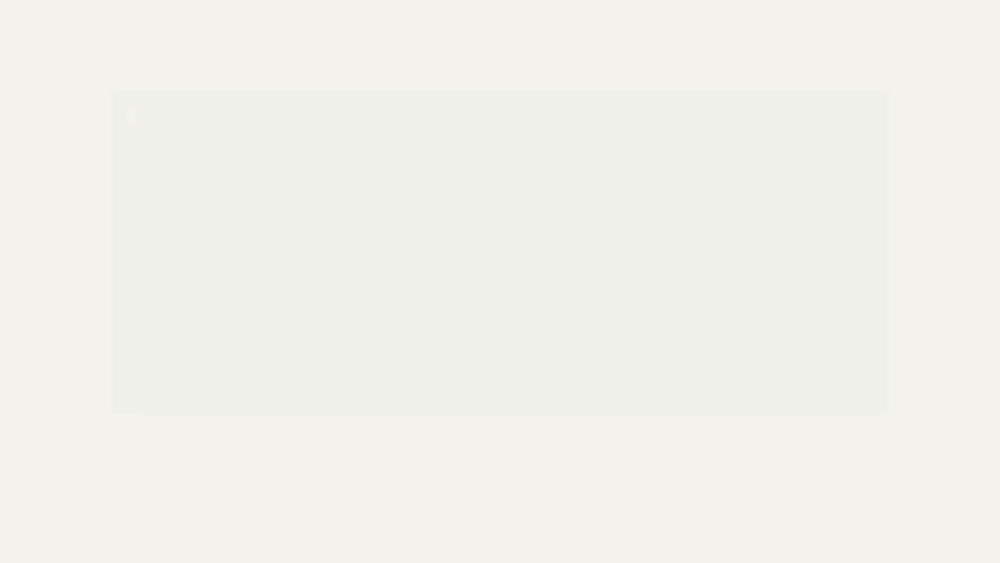
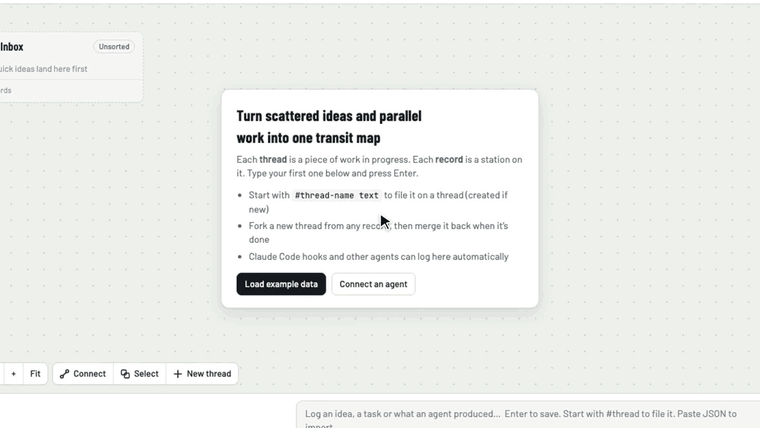
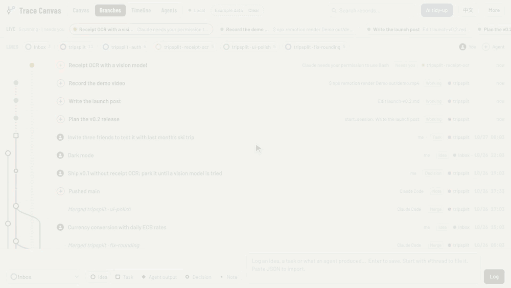
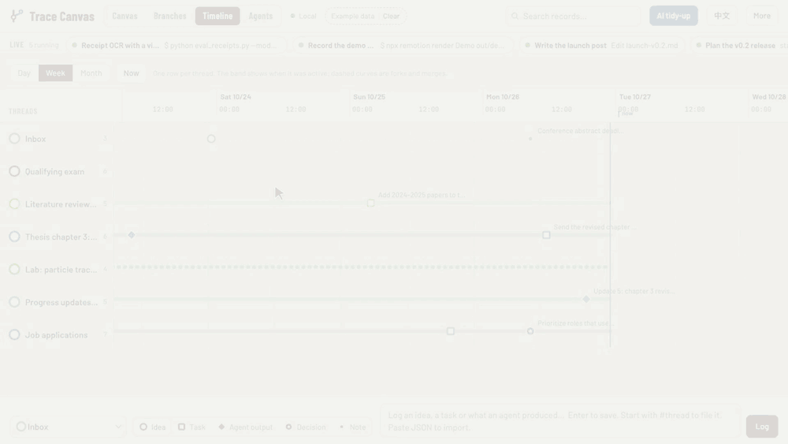
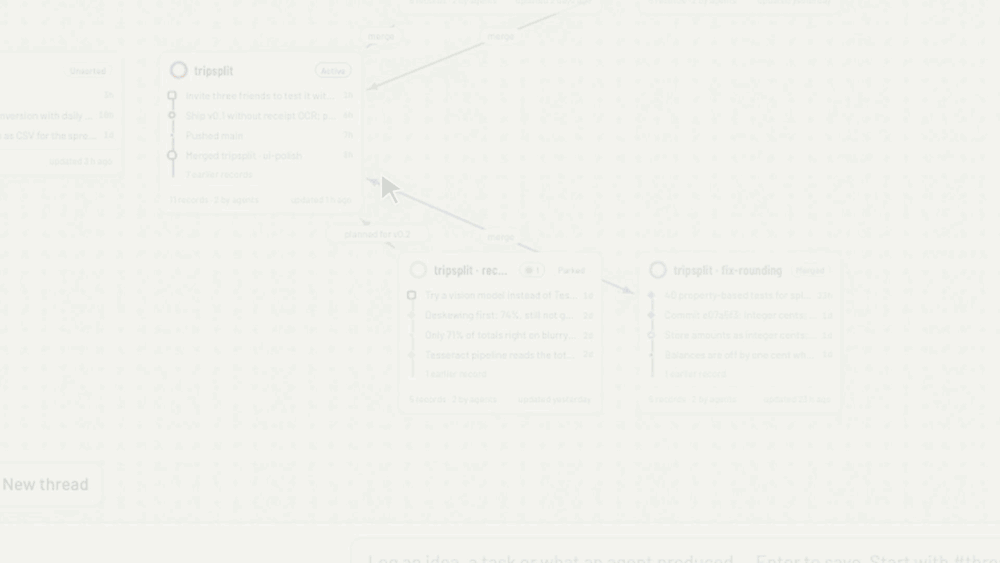
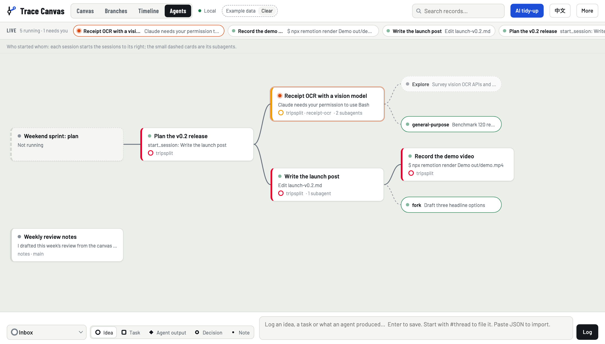
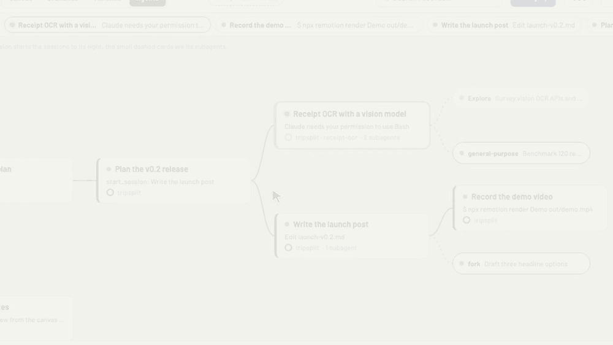
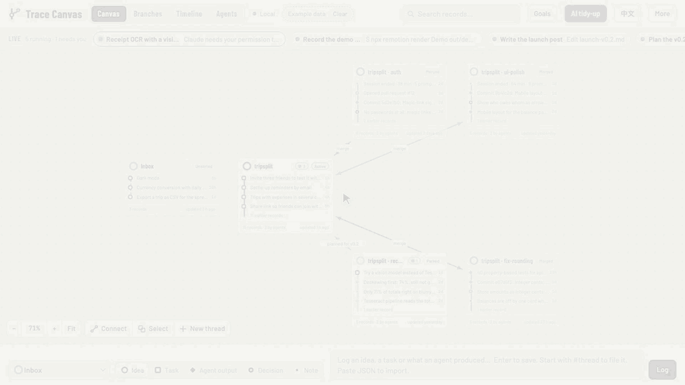
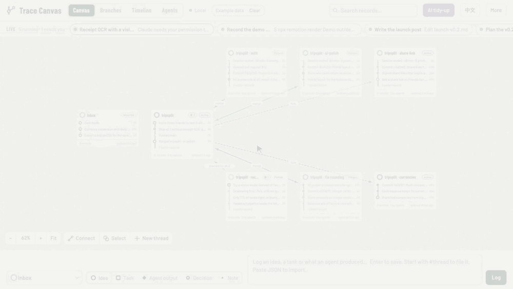
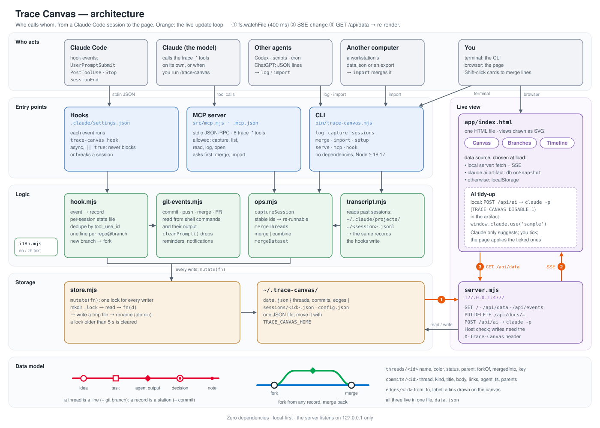

# Trace Canvas

English | [中文](README.zh-CN.md)

Every AI coding session becomes a line on one transit map: your instructions, edits, commits and decisions are its stations, forks and merges are drawn like git, and your agents read the same map to pick up where another left off. Runs locally, needs only Node.js 18.17+, MIT.

**Install: paste this into Claude Code** (or Codex):

> Install Trace Canvas: clone https://github.com/CallSymmetryEcho/trace-canvas.git into ~/trace-canvas, then run `node ~/trace-canvas/bin/trace-canvas.mjs setup --user` (add `--agents codex` if Codex is installed).

**Or by hand:**

```bash
git clone https://github.com/CallSymmetryEcho/trace-canvas.git ~/trace-canvas
node ~/trace-canvas/bin/trace-canvas.mjs setup --user   # hooks, MCP tools and the /trace-canvas skill
```

**Then start a new Claude Code session and type:**

```
/trace-canvas put all my sessions on the canvas
```

It puts this project's past sessions on the map and opens it at <http://localhost:4777/>. From then on every new session lands on it by itself.



## What you see

A transit map of your work. When you work with AI agents, ideas and tasks run in parallel and scatter across sessions. Trace Canvas keeps a trace of them and shows how they relate:

- A **thread** is one piece of work in progress, like a git branch. It is drawn as a line.
- A **record** is a station on that line, like a commit: an idea ○, a task □, agent output ◆, a decision ◉ or a note •.
- **Fork** a new thread from any record and **merge** it back when it is done. Forks and merges are drawn as interchanges.
- The **inbox** holds loose ideas until you file them.

**One entry point for your agents.** Agents can read the same map: through the MCP tools `trace_list_threads` and `trace_read_thread`, a new Claude Code session catches up on all your projects in seconds instead of rereading old chats. Hooks and the `/trace-canvas` skill keep the map up to date while you work.



Videos: [2-minute tutorial](https://github.com/CallSymmetryEcho/trace-canvas/releases/tag/v0.1.0) in English and Chinese.



*Branches: running sessions sit as live tips on top of their lines. The orange one waits for you; once approved it turns green, your decision appears dark and the agent's result in the line's colour. Made-up data.*

Four views of the same data:

| View | What it shows |
| --- | --- |
| Canvas | One card per thread with a mini line map. Drag, zoom, draw labeled links, and select several threads to merge them. |
| Branches | A git graph: every record in time order, one lane per thread, forks and merges as curves. |
| Timeline | A time axis (day / week / month). One row per thread; the band shows when it was active. |
| Agents | The running sessions as a tree: who started whom, and each session's subagents (see [Agent view](#agent-view-who-started-whom)). |



*Timeline: day, week and month. Each band shows when a line was active; dashed curves are forks and merges. Made-up data.*

The page is in English by default. Switch with the **中文 / EN** button in the header.

**What is it good for?** Three scenarios with made-up data (four agents building an app in parallel, three weeks of a PhD student's life, one analysis spread over three agents and two computers), the advantages for vibe coding and AI collaboration, and the open problems: [docs/why.md](docs/why.md).

## Just the page

To look around before setting anything up: `node bin/trace-canvas.mjs` in the clone starts the page at <http://localhost:4777/> (no `npm install`). Click **Load example data** on the empty page for a first look, then **Clear** it from the header. Data is stored in `~/.trace-canvas/data.json`.

Optional: make `trace-canvas` a command.

```bash
echo "alias trace-canvas='node \"$HOME/trace-canvas/bin/trace-canvas.mjs\"'" >> ~/.zshrc
```

## Three ways Claude Code fills the canvas

| | When it happens | What you do |
| --- | --- | --- |
| **Hooks** | Automatically, at key moments of every session | Nothing |
| **`/trace-canvas` skill** | When you ask | Type `/trace-canvas`, or say "put this session on the canvas" |
| **MCP tools** | Whenever Claude decides it fits, or the skill calls them | Nothing; Claude uses them |

One command, run from this folder, sets up all three.

For every project on this computer, run once:

```bash
node bin/trace-canvas.mjs setup --user
```

This adds the hooks to `~/.claude/settings.json`, registers the MCP server with `claude mcp add --scope user`, links the skill into `~/.claude/skills/`, and lets the capture, log and read tools run without asking. Merging and importing always ask first. Use `--project <dir>` instead of `--user` for one project only; Claude Code then asks once, in that project, to approve the `trace-canvas` MCP server.

### Hooks: automatic traces

| When | What gets logged |
| --- | --- |
| The first instruction of a session | a **task** with the full prompt |
| A turn that changed files | **agent output**: the first sentence of Claude's reply, the files changed and the to-dos completed |
| `git commit` | **agent output**: `Commit 1a2b3c4: message` |
| `git push` | a **note**: `Pushed main` |
| `gh pr create` | a **decision** with the pull request link |
| `git merge <branch>` | a **merge** on the current thread; the branch thread is marked merged |
| The session ends | a **note** summarizing duration, prompts, files and commits, with `claude --resume <id>` |

Records go to one thread per repository and branch. Working on `main` logs to `graduation-affair`. Switching to a branch `lit-review` forks a new thread `graduation-affair · lit-review` from where you were, so parallel sessions on different branches land on different lines. Turns that only answer a question are not logged. Files written from the shell (`>`, `tee`, `sed -i`, …) count as changes.

### `/trace-canvas`: put this session on the canvas

| You type | What happens |
| --- | --- |
| `/trace-canvas` | Claude writes 2–6 highlights of this session (decisions, outcomes, next steps), a short summary and a name, and adds them together with the key moments read from the session transcript. |
| `/trace-canvas sessions` | Lists this project's past sessions and which are already on the canvas, and offers to add any of them. |
| `/trace-canvas merge <threads…>` | Merges sessions or threads. Claude confirms the sources, the target and the mode with you first. |
| `/trace-canvas open` | Starts the page and opens it. |
| `/trace-canvas log <text>` | Adds one record. |

Plain language works too: "put this session on the canvas", "把这次会话放进画布", "merge the two survey sessions".

Capturing is safe to repeat: records already on the canvas are skipped. If the hooks already logged the session, the capture completes that thread; ask for "its own line" (`separate`) to pull the session out into a thread of its own.

### MCP tools

| Tool | What it does |
| --- | --- |
| `trace_capture_session` | Puts the current session (or a past one by `session_id`) on the canvas, with the highlights, summary and name Claude passes |
| `trace_list_sessions` | Lists Claude Code sessions of a project from their transcripts |
| `trace_list_threads` | Lists threads with status, record count, last update; `query` searches |
| `trace_read_thread` | Returns the records on one thread |
| `trace_merge` | Merges any number of threads, in `merge` or `combine` mode (below) |
| `trace_fork` | Branches a new thread off a record or a thread's newest record; `bind: true` puts the calling session on it |
| `trace_log` | Adds one record |
| `trace_import_data` | Merges another data set: an export, `data.json` from another computer, or JSON lines |
| `trace_live` | Lists the sessions running now, with status, activity and thread |
| `trace_bind` | Puts a running session (the current one by default) on a thread |
| `trace_tasks` | Returns each thread's goal and its to-dos, with how many are done |
| `trace_task_done` | Ticks a to-do (or reopens it) and records who ticked it |
| `trace_open` | Starts the page if needed and returns its address |

## Live sessions

The local page shows which Claude Code sessions are running right now. A bar under the header lists them, the ones waiting for you first:

| Status | When |
| --- | --- |
| **Working** (green) | Claude is acting; the bar shows the current step, for example `Edit hook.mjs` or `$ npm test` |
| **Needs you** (orange) | A permission prompt, a question for you (`AskUserQuestion`), a plan to approve, or a question from an MCP server |
| **Idle** (grey) | The turn is done; the bar shows the first sentence of Claude's reply |

In every view, stations you wrote (your instructions and decisions) are drawn dark with a person mark, and agents' stations in the line's colour with a star mark, so you can see who moved each line forward. In the Branches view, a session working on a line right now sits at the top of that line's lane as a pulsing tip (green working, orange needs you), joined to the line's newest record; click it for the session panel. Each card shows how many sessions are running on its thread. Click a session to see its repository, branch, folder and latest instruction, copy `claude --resume <id>`, or put it on another thread. A session lands on its repository/branch line by itself; to bind it by hand, pick a thread in the page, run `trace-canvas bind "<thread>"`, or ask Claude (`trace_bind`). From then on its records go to that thread too.

A session stays on its line. The desktop app ends sessions and resumes them under the same id; the line each session is on is kept in the canvas data (not in the session's own state), so a resumed session goes on where it was and does not log its first instruction again. Each thread panel lists **Sessions on this line**, running ones first, each with a button that copies the command that resumes it from its folder (`cd … && claude --resume <id>`, `codex resume <id>`). The same list comes from `trace-canvas resume "<thread>"` and from `trace_read_thread`, so you or another agent can pick a line's session up again instead of starting a new one. When you combine lines, the line you keep takes over the folded lines' repository key and ids, so sessions in that folder, bound or not, land on it instead of on a re-created folder line.



Live status needs the SessionStart, PreToolUse, Notification and SubagentStart/Stop hooks, which `setup` adds (run it again after updating). It lives in small files in `~/.trace-canvas/live/` (one per session and one per subagent), apart from your records. A session drops off when it ends, or after 12 hours without activity. Only the local page shows live sessions.

### Agent view: who started whom

The **Agents** tab draws the running agents as a tree, left to right. Each session starts the sessions to its right; the small dashed cards are its subagents (Explore, general-purpose, forks, …), green while they run. A session that started others but is no longer running stays in the chain as a dashed "not running" card, and the tree that holds a session needing you comes first. Click a session for the same panel as in the live bar, now with who started it, the sessions it started and its subagents with their last message.





*A session waiting for approval turns green once approved, a subagent finishes and fades, and the panel shows who started the session. Made-up data.*

Subagents come from the SubagentStart/Stop hooks and the `.meta.json` file Claude Code keeps next to each subagent transcript. Which session started which comes from the Claude desktop app's own session records (`~/Library/Application Support/Claude/claude-code-sessions/`), read-only and best-effort: that format belongs to the app and may change, and without the desktop app every session simply starts its own tree. `TRACE_CANVAS_DESKTOP_DIR` points it somewhere else. The made-up sessions in the screenshot come from `node docs/scenarios/agents.mjs <data dir> <desktop dir>`.

## Goals and to-dos: working with agents asynchronously

**Goals** in the header opens one list of what you want to achieve and how far along it is, without adding anything to the main page:

| | What it is | Where it lives |
| --- | --- | --- |
| **Goal** | The outcome a line is working towards | The line's "Goal and context" field |
| **To-do** □ | A concrete next step that you or an agent can take, ticked when done | A task record on the line |
| **Progress** | What actually happened | Agent output, commits, decisions |
| **Inbox** | Loose ideas you have not thought through yet | The inbox |

The list groups to-dos by line, shows each line's goal, a progress bar (done/total) and whether a session is working on it right now. Tick a to-do or add one right there. The first instruction of each session, which the hooks log as a task, is a record of what was asked, so it stays out of the list; next steps Claude writes when capturing a session do show up.

Agents use the same list. At the start of work they read the goal and the open to-dos with `trace_tasks`; when they finish one they call `trace_task_done`, and the list shows who ticked it. So you can write down what you want, let agents work while you are away, and come back to see where things stand. New ideas get on the list as you say them: with every message, the hook tells the agent which line it works on and what is already open, and the agent adds each new goal or next step with `trace_log` (`kind: "task"`); the same open to-do twice stays one. From the command line: `trace-canvas tasks` and `trace-canvas done "<to-do>"` (`--agent Codex` for a script or another agent).



*Agents tick to-dos off on the shared list, one by Claude Code and one by Codex, and the line's progress bar moves forward. Made-up data.*

## Several agents on one machine: Claude Code, Codex, Gemini CLI

Claude Code, Codex and Gemini CLI can share the canvas and split the work through to-dos:

```bash
node bin/trace-canvas.mjs setup --user --agents codex,gemini
```

This adds the hooks to `~/.codex/hooks.json` and `~/.gemini/settings.json` (after any hooks already there, with a backup) and registers the MCP server with each CLI. Codex runs hooks inside its `workspace-write` sandbox, which blocks writes outside the project, so setup also adds `~/.trace-canvas` to `writable_roots` under `[sandbox_workspace_write]` in `~/.codex/config.toml` (with a backup). Start Codex once afterwards and trust the new hooks when it asks. CLIs that are not installed are skipped.

- **Who does what:** each to-do in **Goals** has a "who does it" choice (Claude Code, Codex, Gemini CLI or anyone). Agents read their own with `trace_tasks` (`mine: true`) and tick them with `trace_task_done`, and the list shows who ticked each one.
- **Hand it over:** **Hand to it** next to an assigned to-do copies a command, and so does `trace-canvas hand "<to-do>" --to codex`. The command starts that agent in the line's folder with `TRACE_CANVAS_THREAD` set, so the new session lands on the line.
- **A head start:** when any of the three starts a session, the hook tells it which line it works on, the line's goal, the to-dos assigned to it, who else is working there, and (with the location map) where things are on this machine.
- Records, live tips and the Agent view show which agent did what. Each session gets its own resume command: `claude --resume`, `codex resume` or `gemini --resume`.

Codex has no notification event, so a permission request stands in for "needs you". Checked against real Codex 0.164 sessions (`test/fixtures/codex/`): prompts, shell commands, `apply_patch` edits, commits, permission requests, the context at session start and ticking a to-do over MCP. Gemini CLI support follows its documented hook events and will be checked against a current `@google/gemini-cli`.

## Merging sessions and threads

Several sessions about the same piece of work can become one line, in two ways:

- **Merge** keeps every source line, marks it merged and draws the merge into the target, like git. History stays visible.
- **Combine** moves every record onto the target in time order and removes the source threads. Links to them now point to the target.

The target can be an existing thread or a new one. Three places to do it:

- **On the canvas**: Shift-click cards (or turn on **Select** in the toolbar, handy on touch screens), pick a target or type a new name, then **Merge** or **Combine**.
- **In Claude Code**: `/trace-canvas merge`, or ask in your own words.
- **On the command line**: `trace-canvas merge "Survey A" "Survey B" --into "Survey analysis" --combine`.

Data from another computer (for example a workstation) merges with `trace-canvas import other-data.json`. Threads with the same repository/branch or session key, or the same name, become one line, and records already present are skipped.



*On the canvas: a close look at one card (dark stations are yours, coloured ones the agents'), then Shift-click two lines, pick the target and **Merge**. Made-up data.*

## Tuning the hooks

Set these in `~/.trace-canvas/config.json` or as environment variables:

| Setting | Env variable | Values | Default |
| --- | --- | --- | --- |
| `lang` | `TRACE_CANVAS_LANG` | `en`, `zh`: language of records the hooks write | `en` (switching the page language also switches this) |
| `group` | `TRACE_CANVAS_GROUP` | `branch`, `repo`, `session`: what one thread stands for | `branch` |
| `prompts` | `TRACE_CANVAS_PROMPTS` | `first`, `long` (60+ characters), `all`, `none` | `first` |
| `turns` | `TRACE_CANVAS_TURNS` | `changes` (turns that changed something), `all`, `none` | `changes` |

`TRACE_CANVAS_DISABLE=1` turns the hooks off for one session. `TRACE_CANVAS_HOME` moves the data folder. `TRACE_CANVAS_DEBUG=1` writes every hook event to `~/.trace-canvas/debug.log`.

## Logging from other agents and scripts

Any agent, script or cron job can log one line:

```bash
node bin/trace-canvas.mjs log "Finished the literature table" \
  --thread "Proposal" --kind agent --agent Codex --link https://example.com/doc
```

Agents without shell access (ChatGPT, for example) can end their answer with JSON lines. Paste the whole output into the box at the bottom of the page and press Enter, or run `trace-canvas import file.jsonl`:

```json
{"thread": "Proposal", "kind": "agent", "title": "Outlined chapter 2", "body": "Next: figures", "agent": "ChatGPT"}
```

## AI tidy-up

If the `claude` command is installed, **AI tidy-up** in the header asks Claude to file inbox records into threads, suggest links between threads and point out threads that look stalled. Nothing changes until you tick the suggestions and apply them. It runs `claude -p` on your own account; the hooks are switched off for that call.

## Commands

```text
Page
  trace-canvas [serve] [--port 4777] [--no-open]   Start the page and open it

Records
  trace-canvas log "title" [--thread T] [--kind K] [--body B] [--link URL] [--agent A]
  trace-canvas capture [--session ID] [--project DIR] [--thread T] [--separate] [--all]
  trace-canvas sessions [--project DIR]            List Claude Code sessions of a project
  trace-canvas merge <thread>... --into <thread> [--combine]
  trace-canvas fork <record|thread> [--name N] [--bind]   Branch a new thread off another
  trace-canvas hand <to-do|thread> --to claude|codex|gemini Assign it and print the command that starts the agent
  trace-canvas import <file|->                     Merge an export, another data.json, or JSON lines

Goals and to-dos
  trace-canvas tasks [--thread T] [--all]          Each thread's goal and open to-dos
  trace-canvas done <to-do> [--thread T] [--agent A] [--undo]
                                                   Tick a to-do by id or title

Live sessions
  trace-canvas live                                Running sessions: status, activity, thread
  trace-canvas bind <thread> [--session ID]        Put a running session on a thread (default: this one)
  trace-canvas bind --unbind [--session ID]        Back to its repository/branch line
  trace-canvas resume <thread>                     The line's sessions, newest first, each with the command that resumes it

Setup (--user for every project, --project DIR for one)
  trace-canvas setup            Hooks + MCP server + skill
  trace-canvas install-hooks | install-mcp | install-skill | uninstall-hooks
  trace-canvas mcp              Run the MCP server on stdio (Claude Code starts this)
  trace-canvas lang <en|zh>     Language of records the hooks write
  trace-canvas where            Show where the data is stored
```

## Online version

The same page also runs as a claude.ai artifact, with its data in the artifact's own database: <https://claude.ai/artifact/Y7kykkrWyU4rH31MttYLMj>. The local version and the online version keep separate data; use **More → Import / export** to move data between them.

## How it works



```text
app/index.html        The page. Works against the local server, a claude.ai artifact database, or browser storage.
bin/trace-canvas.mjs  Command line entry point.
skill/SKILL.md        The /trace-canvas skill.
src/server.mjs        Local server on 127.0.0.1: page, JSON API, live updates over server-sent events.
src/mcp.mjs           MCP server (stdio JSON-RPC, no dependencies).
src/hook.mjs          Claude Code hook handler.
src/live.mjs          Live sessions: one status file per running session and per subagent, written by the hooks.
src/desktop.mjs       Which session started which, read from the Claude desktop app's session records.
src/transcript.mjs    Reads Claude Code session transcripts (~/.claude/projects/…/<session>.jsonl).
src/ops.mjs           Capturing sessions, merging threads, merging data sets.
src/git-events.mjs    Reads commits, pushes, merges and pull requests from shell commands and their output.
src/store.mjs         The data file. A directory lock keeps parallel processes from overwriting each other.
src/install.mjs       Adds or removes hooks, the MCP server, the skill and permissions.
src/demo.mjs          Example data in English and Chinese.
test/                 node --test suites (npm test), with transcript fixtures.
docs/architecture.mjs Draws the architecture diagram (English and Chinese SVG).
docs/scenarios/       Made-up scenario data and the script that renders their screenshots.
```

Data model, stored as one JSON file:

```text
threads/<id>  name, color, status (active | parked | done | merged), parent, forkOf, mergedInto, x, y, note,
              key (repo, repo@branch or session:<id>)
commits/<id>  thread (or "inbox"), kind (idea | task | agent | decision | note | fork | merge), title, body,
              links[], agent, ts, parents[], done, mergeOf?, session?
edges/<id>    from, to, label
```

The server only listens on 127.0.0.1, checks the `Host` header, and requires an `X-Trace-Canvas` header on every write, so other websites open in your browser cannot change your data.

Run the tests with `npm test` in this folder.

## License

MIT, see [LICENSE](LICENSE).
