# Trace Canvas 留痕

[English](README.md) | 中文

每个 AI 编程会话都是同一张地铁图上的一条线：你的指令、改动、提交和决定是线上的站点，分叉与合并像 git 一样画出来，你的 agent 也读同一张图，接着别人停下的地方继续做。本地运行，只需要 Node.js 18.17+，MIT 开源。

**安装：把这句话贴给 Claude Code**（或 Codex）：

> 安装 Trace Canvas：把 https://github.com/CallSymmetryEcho/trace-canvas.git 克隆到 ~/trace-canvas，然后运行 `node ~/trace-canvas/bin/trace-canvas.mjs setup --user`（装了 Codex 的话加上 `--agents codex`）。

**或者手动：**

```bash
git clone https://github.com/CallSymmetryEcho/trace-canvas.git ~/trace-canvas
node ~/trace-canvas/bin/trace-canvas.mjs setup --user   # hooks、MCP 工具和 /trace-canvas skill
```

**然后新开一个 Claude Code 会话，输入：**

```
/trace-canvas 把现在所有的会话展示在画布上
```

它会把这个项目过去的会话放上地图，并在 <http://localhost:4777/> 打开。之后每个新会话都会自动出现在上面。


## 你会看到什么

把 AI agent 办公时零碎的想法和并行的工作，画成一张「地铁线路图」：

- **线程**：一件在推进的事，相当于 git 分支，画成一条线路。
- **记录**：线路上的站点，相当于提交：想法 ○、任务 □、Agent 产出 ◆、决策 ◉、笔记 •。
- 可以从任意记录**分叉**出新线程，做完再**合并**回去，分叉与合并画成换乘站。
- **收件箱**放还没归类的零碎想法。

**agent 的统一入口。** 这张图 agent 也能读：通过 MCP 工具 `trace_list_threads` 和 `trace_read_thread`，新开的 Claude Code 会话几秒钟就能了解你手上所有项目的进展，不用再翻旧聊天记录。工作时，hooks 和 `/trace-canvas` skill 会自动更新这张图。

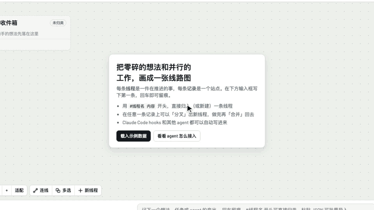

视频：[中英文教程](https://github.com/CallSymmetryEcho/trace-canvas/releases/tag/v0.1.0)。

宣传站：https://trace-canvas.bin-lian.com（源文件在 [`site/`](site/README.md)），一页导览，沿着一张随滚动生长的分支图介绍功能，还有功能演示和教程视频（本地预览：`python3 -m http.server -d site`）。

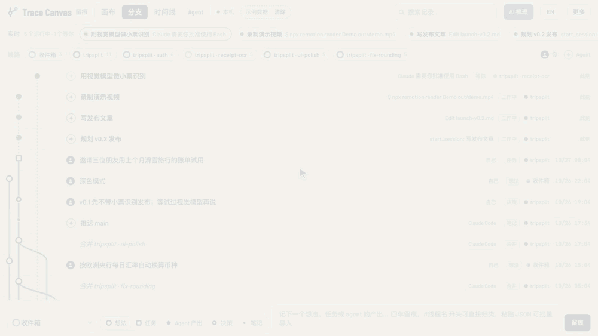

*分支视图：正在运行的会话以线头显示在各自线路的顶端。橙色的在等你；批准后变绿，你的决定显示为深色，agent 的产出用线路的颜色。虚构数据。*

同一份数据，四个视图：

| 视图 | 用途 |
| --- | --- |
| 画布 | 每条线程是一张带迷你线路图的卡片，可拖拽、缩放、画带标签的关联，也可以多选线程一起合并 |
| 分支 | git graph：所有记录按时间排列，每条线程一条泳道，分叉与合并画成曲线 |
| 时间线 | 横向时间轴（日 / 周 / 月），每行一条线程，色带是它活跃的时段 |
| Agent | 正在运行的会话画成一棵树：谁启动了谁，以及每个会话的子 agent（见 [Agent 视图](#agent-视图谁启动了谁)） |

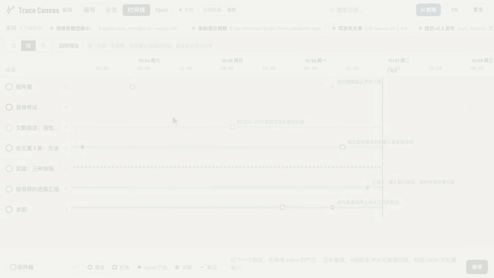

*时间线：按日、周、月查看。色带是每条线活跃的时段，虚线曲线是分叉与合并。虚构数据。*

页面默认英文，点右上角 **中文 / EN** 切换。**更多 → 主题**可以在跟随系统、浅色、深色和雾蓝之间切换；雾蓝是一套淡雅的蓝灰配色，线路颜色也会随之变柔和。

**它能用来做什么？** 用虚构数据演示的三个场景（四个 agent 并行做一个应用、一个研究生的三周、一项分析分散在三个 agent 和两台电脑上），它在 vibe coding 和 AI 协作中的优势，以及还没解决的问题：[docs/why.zh-CN.md](docs/why.zh-CN.md)。

## 只看页面

想先看看再配置：在克隆下来的目录里运行 `node bin/trace-canvas.mjs`，会在 <http://localhost:4777/> 打开页面（不用 `npm install`）。空页面上点 **Load example data（载入示例数据）** 先看效果，看完在顶栏点「清除」。数据保存在 `~/.trace-canvas/data.json`。

可选：加个快捷命令。

```bash
echo "alias trace-canvas='node \"$HOME/trace-canvas/bin/trace-canvas.mjs\"'" >> ~/.zshrc
```

## Claude Code 写入画布的三种方式

| | 什么时候发生 | 你要做什么 |
| --- | --- | --- |
| **Hooks** | 每个会话的关键节点自动记录 | 什么都不用做 |
| **`/trace-canvas` skill** | 你主动调用时 | 输入 `/trace-canvas`，或者直接说「把这次会话放进画布」 |
| **MCP 工具** | Claude 判断合适时，或 skill 调用时 | 什么都不用做，Claude 自己用 |

在这个文件夹里运行一条命令，三样都会配好。

要对这台电脑上的所有项目开启，运行一次：

```bash
node bin/trace-canvas.mjs setup --user
```

它会把 hooks 写进 `~/.claude/settings.json`，用 `claude mcp add --scope user` 注册 MCP 服务，把 skill 链接到 `~/.claude/skills/`，并让「放进画布、记录、读取」这几个工具不用每次确认。合并和导入始终会先问你。只对某个项目开启时，把 `--user` 换成 `--project <目录>`；之后 Claude Code 会在那个项目里问一次是否批准 `trace-canvas` MCP 服务。

### Hooks：自动留痕

| 时机 | 记下什么 |
| --- | --- |
| 会话的第一条指令 | 一条**任务**，带完整指令 |
| 改动了文件的回合 | **Agent 产出**：Claude 回复的第一句话、改动的文件、完成的待办 |
| `git commit` | **Agent 产出**：`Commit 1a2b3c4: 提交说明` |
| `git push` | **笔记**：`Pushed main` |
| `gh pr create` | **决策**，带 PR 链接 |
| `git merge <分支>` | 当前线程上一条**合并**，被合并的分支线程标为已合并 |
| 会话结束 | **笔记**：时长、指令数、文件数、提交数，以及 `claude --resume <id>` |

记录按「仓库 + 分支」归到线程。在 `main` 上工作记到 `graduation-affair`；切到分支 `lit-review` 时，会从当前位置分叉出新线程 `graduation-affair · lit-review`。这样不同分支上并行的会话会落在不同的线路上。只是回答问题的回合不记录；用 shell 写文件（`>`、`tee`、`sed -i` 等）也算改动。

### `/trace-canvas`：把当前会话放进画布

| 你输入 | 发生什么 |
| --- | --- |
| `/trace-canvas` | Claude 为这次会话写 2–6 条要点（决策、产出、下一步）、一段简短总结和一个线程名，再加上从会话记录里读出的关键节点，一起放进画布 |
| `/trace-canvas sessions` | 列出这个项目过去的会话，标出哪些已经在画布上，可以挑着加进去 |
| `/trace-canvas merge <线程…>` | 合并会话或线程。Claude 会先跟你确认来源、目标和合并方式 |
| `/trace-canvas open` | 启动并打开页面 |
| `/trace-canvas log <内容>` | 记一条 |

直接用自然语言也行：「把这次会话放进画布」「put this session on the canvas」「把两次问卷分析的会话合并」。

重复放进去没关系，已经在画布上的记录会跳过。如果 hooks 已经记过这次会话，会补全到那条线程上；想让这次会话「单独成一条线」时（`separate`），会把它的记录移到新线程里。

### MCP 工具

| 工具 | 作用 |
| --- | --- |
| `trace_capture_session` | 把当前会话（或用 `session_id` 指定的过去会话）放进画布，附上 Claude 写的要点、总结和线程名 |
| `trace_list_sessions` | 从会话记录文件列出某个项目的 Claude Code 会话 |
| `trace_list_threads` | 列出线程：状态、记录数、最近更新；`query` 可搜索 |
| `trace_read_thread` | 读取一条线程上的记录 |
| `trace_merge` | 合并任意多条线程，`merge` 或 `combine` 两种方式（见下） |
| `trace_fork` | 从一条记录或一条线最新的记录分出新线；`bind: true` 时把调用它的会话放到新线上 |
| `trace_log` | 记一条 |
| `trace_import_data` | 合并另一份数据：导出文件、另一台电脑的 `data.json`、或 JSON 行 |
| `trace_live` | 列出正在运行的会话：状态、当前动作、所属线 |
| `trace_bind` | 把一个运行中的会话（默认是当前会话）放到某条线上 |
| `trace_tasks` | 返回会话所在这条线的目标和待办，以及完成了几项（`thread` 指定别的线，`all: true` 返回所有线） |
| `trace_task_done` | 勾选一项待办（或重新打开），并记下是谁勾的 |
| `trace_open` | 必要时启动页面，返回地址 |

## 实时会话

本地页面会显示此刻有哪些 Claude Code 会话在运行。页头下方的一栏列出它们，等你处理的排在最前：

| 状态 | 什么时候 |
| --- | --- |
| **工作中**（绿色） | Claude 正在干活，栏里显示当前这一步，比如 `Edit hook.mjs` 或 `$ npm test` |
| **等你**（橙色） | 等你批准权限、回答问题（`AskUserQuestion`）、确认计划，或回答 MCP 服务的提问 |
| **空闲**（灰色） | 这一轮做完了，栏里显示 Claude 回复的第一句 |

所有视图里，你写的站点（你的指令和决定）画成深色并带人形标记，agent 的站点用线路颜色并带星形标记，一眼能看出每条线是谁推进的。分支视图里，正在某条线上工作的会话会出现在这条泳道的顶端，是一个脉动的线头（绿色是工作中，橙色是等你），并用虚线连到这条线最新的记录；点它会打开会话面板。每张卡片会显示这条线上有几个会话在运行。点开一个会话，可以看到它的仓库、分支、目录和最近的指令，复制 `claude --resume <id>`，或者把它换到另一条线。Claude 桌面 app 里的会话还有**打开对话**按钮（Agent 视图里是 ↗），点一下就回到 app 里的那个对话；Codex 的会话会在 Codex app 里打开；在 Mac 的 Terminal 或 iTerm2 里运行的会话有**跳到终端**，会把它所在的标签页切到最前。会话默认按仓库和分支自动归线；要手动绑定，可以在页面上选线，运行 `trace-canvas bind "<线名>"`，或者让 Claude 来做（`trace_bind`）。绑定之后，这个会话的记录也会记到那条线上。

会话会一直留在它的线上。桌面 app 会结束会话进程，之后再用同一个 id 恢复；每个会话在哪条线上，记在画布数据里（不再放在会话自己的状态文件里），所以恢复后的会话会接着记在原来的线上，也不会把第一条指令再记一遍。每条线的面板里有「这条线上的会话」，运行中的排在前面，每个都有按钮复制从它的目录恢复它的命令（`cd … && claude --resume <id>`、`codex resume <id>`）。`trace-canvas resume "<线名>"` 和 `trace_read_thread` 也能拿到同一份列表，你或别的 agent 可以接着这条线上的会话做，不用新开。合并（combine）几条线时，保留下来的线会接管被并掉的线的仓库 key 和 id，所以那个文件夹里的会话，不论是否绑定，都会记到它上面，而不是重新建一条文件夹的线。

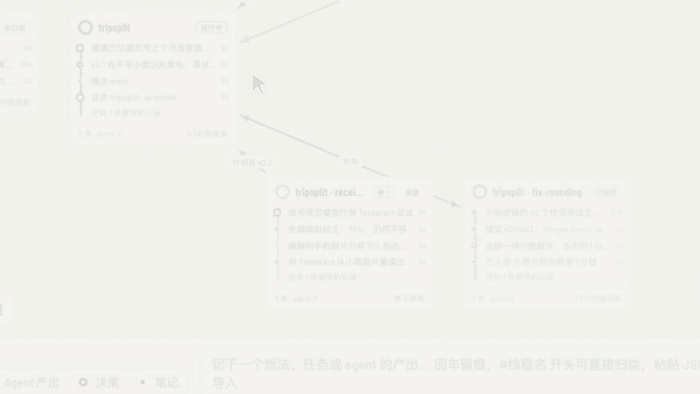

实时状态需要 SessionStart、PreToolUse、Notification 和 SubagentStart/Stop 这几个 hook，`setup` 会自动加上（更新后再运行一次）。状态存在 `~/.trace-canvas/live/` 里，每个会话、每个子 agent 各一个小文件，和你的记录分开。会话结束或 12 小时没有动静后就不再显示。只有本地页面能看到实时会话。

### Agent 视图：谁启动了谁

**Agent** 标签页把正在运行的 agent 画成一棵从左到右的树。每个会话启动它右边的会话；虚线小卡片是它的子 agent（Explore、general-purpose、fork 等），运行中显示为绿色。启动过别的会话、自己已经不在运行的会话，会以虚线的"未运行"卡片留在链条里；有会话在等你的那棵树排在最前。点开一个会话，看到的面板和实时栏里的一样，另外多了：由谁启动、它启动的会话，以及各个子 agent 和它们最后一句话。

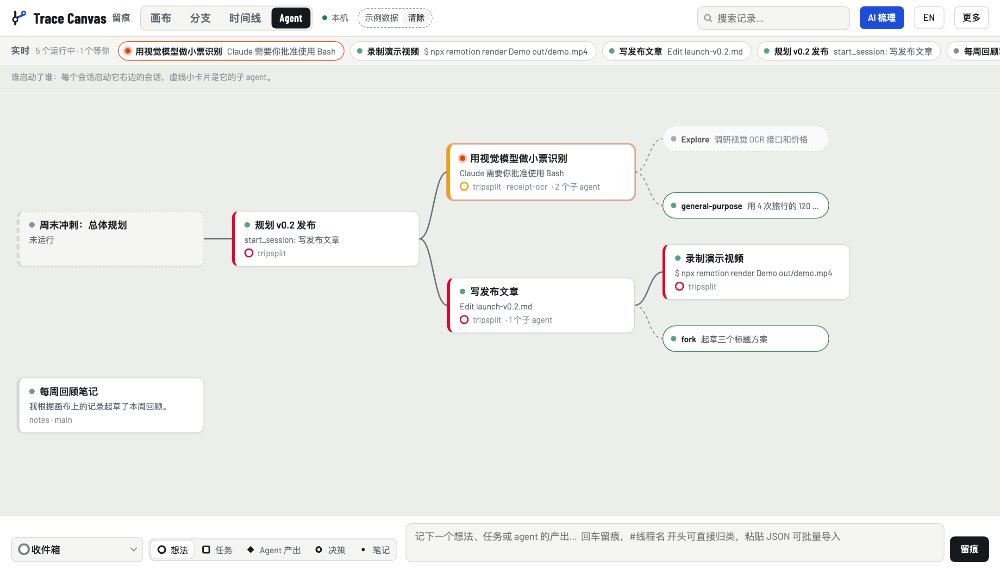

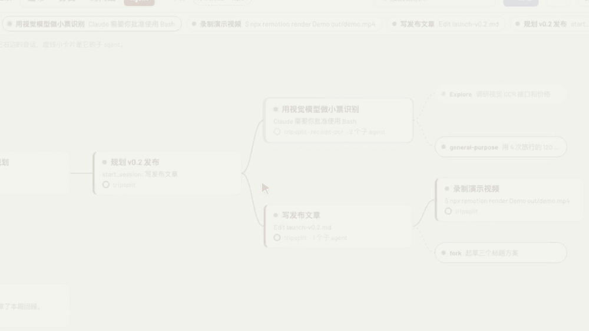

*等待批准的会话批准后变成绿色，子 agent 完成后变淡，面板显示这个会话由谁启动。虚构数据。*

子 agent 来自 SubagentStart/Stop 这两个 hook，以及 Claude Code 在每个子 agent 会话记录旁边保存的 `.meta.json`。谁启动了谁，读的是 Claude 桌面版自己的会话记录（`~/Library/Application Support/Claude/claude-code-sessions/`），只读、尽力而为：这个格式属于桌面版，随时可能变；没有桌面版时，每个会话各自成一棵树。可以用 `TRACE_CANVAS_DESKTOP_DIR` 指向别的位置。截图里的虚构会话由 `node docs/scenarios/agents.mjs <数据目录> <桌面记录目录>` 生成。

## 目标和待办：和 agent 异步推进

页头的**目标**按钮会打开一个清单，列出你想达到什么、做到哪了，主页面不会因此多出任何东西：

| | 是什么 | 放在哪 |
| --- | --- | --- |
| **目标** | 一条线要达到的结果 | 这条线的"目标和背景"字段 |
| **待办** □ | 具体的下一步，你或 agent 都可以去做，做完勾上 | 线上的任务记录 |
| **进度** | 实际发生了什么 | agent 的产出、提交、决定 |
| **收件箱** | 还没想清楚的零散想法 | 收件箱 |

清单按线分组，显示每条线的目标、进度条（完成/总数），以及此刻有没有会话在做。待办可以直接在清单里勾选或新增，点一下线的目标就能改；在手机上，点开一项待办就能编辑它。hooks 记下的每个会话第一条指令，记录的是"当时要求做什么"，不算待办，不会出现在清单里；Claude 导入会话时写下的"下一步"会出现。

agent 用的是同一份清单：开工时用 `trace_tasks` 读目标和待办，做完一项就调用 `trace_task_done`，清单上会标出是谁勾的。这样你写下想要的结果，离开时 agent 照样推进，回来一看就知道做到哪了。你说出的新想法也会随时进清单：每条消息发出时，hook 会告诉 agent 它在哪条线上、哪些待办已经有了，agent 再用 `trace_log`（`kind: "task"`）把新的目标和下一步加进去；同一条未完成的待办不会重复出现。命令行里是 `trace-canvas tasks` 和 `trace-canvas done "<待办>"`（脚本或其他 agent 加 `--agent Codex`）。

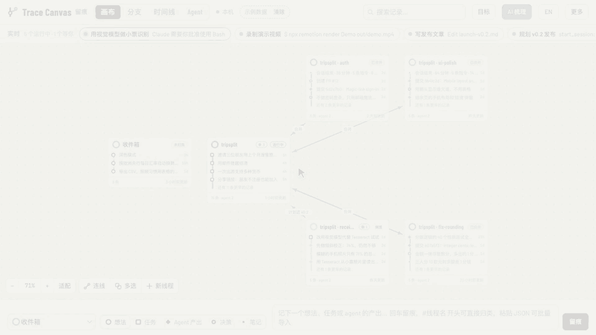

*agent 在共用的清单上勾掉待办：一项由 Claude Code 勾选，一项由 Codex 勾选，这条线的进度条随之前进。虚构数据。*

## 一台机器上多个 agent 分工：Claude Code、Codex、Gemini CLI

Claude Code、Codex 和 Gemini CLI 可以共用同一张画布，通过待办分工：

```bash
node bin/trace-canvas.mjs setup --user --agents codex,gemini
```

这条命令会把 hooks 加进 `~/.codex/hooks.json` 和 `~/.gemini/settings.json`（排在已有 hooks 之后，并先做备份），再在两个 CLI 里注册 MCP 服务。Codex 会在它的 `workspace-write` 沙盒里运行 hooks，沙盒不允许写项目以外的地方，所以这条命令还会把 `~/.trace-canvas` 加进 `~/.codex/config.toml` 里 `[sandbox_workspace_write]` 的 `writable_roots`（同样先做备份）。之后启动一次 Codex，它问到时信任新的 hooks。没安装的 CLI 会自动跳过。

对于 Codex，setup 还会把 skill 链接到 `~/.agents/skills/trace-canvas`。用 `$trace-canvas` 调用，例如 `$trace-canvas tasks`。已有安装只补 skill 时，运行 `node bin/trace-canvas.mjs install-skill --user --agents codex`；换成 `--project <目录>` 就装到该目录的 `.agents/skills/trace-canvas`。skill 链接到这份仓库，后续拉取更新也会同步生效。

- **谁做什么**：**目标**清单里每项待办都能选"由谁做"（Claude Code、Codex、Gemini CLI 或任何人）。agent 用 `trace_tasks`（`mine: true`）读分给自己的待办，做完用 `trace_task_done` 勾上，清单会标出是谁勾的。
- **交出去**：已指定的待办旁边有**交给它**按钮，会复制一条命令；`trace-canvas hand "<待办>" --to codex` 也能打印同样的命令。这条命令在这条线的目录里启动那个 agent，并设置 `TRACE_CANVAS_THREAD`，新会话一开始就落在这条线上。在 macOS 上，旁边的**在终端打开**会直接在新的终端窗口里运行这条命令。agent 也可以自己领下一条待办：`/trace-canvas pick`（Codex 里是 `$trace-canvas pick`）。
- **分派**：对一个 agent 说「分派」（`/trace-canvas dispatch`，在手机上的 Claude app 里也行），每条线上新记的待办就交给正在做这条线的 agent，也就是最后在这条线上留下记录的那个会话。正在运行的 Claude Code 会话由这个 agent 发消息过去；已经停了的会话带着待办恢复；没人做的线新开一个会话（Claude Code 会打开 Remote Control，在 Claude app 里看得到）。在 macOS 上，每个都在新的终端窗口里打开。「新」是指还没人认领、那个 agent 也还不知道的待办：你自己记的（在页面、手机或命令行上），或者别的会话替这条线记的。分出去的待办就有了主人，不会再分一次（`--all` 连这条线的 agent 自己记的也分）。点名一条待办（而不是一条线），就只分这一条，不管是谁记的。命令行：`trace-canvas dispatch [线|待办…]`，加 `--print` 只打印命令。
- **回到那次对话**：agent 记下的每条记录都保存了是在哪个会话里记的。记录面板里**记在这个会话里**一栏可以打开那次对话或复制恢复命令，`trace_read_thread` 里是 `from`。
- **开局就知道情况**：三个 agent 无论哪个开新会话，hook 都会告诉它：在哪条线上、线的目标、分给它的待办、还有谁在这条线上，以及（配好位置地图时）本机上的东西在哪里。
- 记录、实时线头和 Agent 视图都会标出是哪个 agent 做的。每个会话都有自己的恢复命令：`claude --resume`、`codex resume` 或 `gemini --resume`。

Codex 没有通知事件，所以用权限请求来表示"等你"。这些已经用真实的 Codex 0.164 会话核对过（`test/fixtures/codex/`）：指令、shell 命令、`apply_patch` 改文件、提交、权限请求、会话开始时的上下文，以及通过 MCP 勾掉待办。Gemini CLI 的支持按它文档里的 hook 事件实现，还要用最新的 `@google/gemini-cli` 实际核对。

## 多台电脑，同一张画布

笔记本、工作站和实验室电脑可以通过一个它们都能访问的私有 git 仓库共用一张画布。给每台机器起个名字，并指向这个仓库的克隆：

```bash
node bin/trace-canvas.mjs setup --user --machine laptop --map ~/agent-map
node bin/trace-canvas.mjs sync
```

每台机器只往里面写自己的 `canvas/<机器>.jsonl`：每条线、每条记录、每条连线和每个会话，连同它最后一次改动的时间。同步时先拉取，再从其他机器的文件里逐份取最新的版本，写好这台机器的文件后推送。可以运行 `trace-canvas sync`，或在页面上点**更多 → 和其他电脑同步**；某台机器手动同步过一次之后，会话结束时也会在后台自动同步。没有网络时同步会说明，下次再推送。

- **哪些内容会被同步：** 会话的第一条指令只带标题，公网 IP 和像密钥的文字会被替换掉。你本机的数据保留全部内容。
- **一个仓库一条线：** 仓库的线按远程地址里的名字命名，所以同一个仓库不管文件夹叫什么，在每台机器上都是同一条线。属于仓库的线在各处 id 相同；旧 id 留作别名，用旧 id 的绑定和工具照样能找到。
- **谁的是谁的：** 来自别的机器的记录和会话会标出机器名，恢复命令通过 `ssh -t <机器>` 执行，所以机器名最好和 ssh 别名一致。
- **新电脑：** 如果这个仓库里还有一张位置地图（`tools/where.py`，记录代码、数据和 NAS 目录在每台机器上的位置），那里的会话一开始就会被告知东西在哪；`trace_where` 和 `trace-canvas where <关键词>` 可以查询；仓库里的 `bootstrap.sh` 能一次装好一台新电脑。另一台电脑已经在用的名字，`setup` 会拒绝。

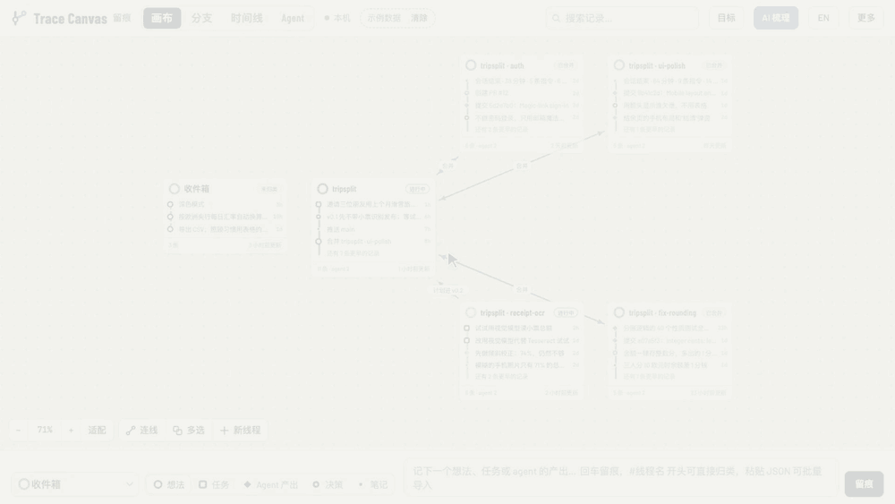

## 看改了什么

提交站点的面板里有一栏**改动**：这次提交改过的每个文件，改得最多的在前，标出加了几行、删了几行；lock 文件、构建产物和二进制文件折叠在最后。点一个文件就看它的 diff。**对比**可以选同一条线或同一个仓库里的另一个提交站点，看两者之间改了什么。agent 某一轮改了文件的话，会指向这个会话之后的那次提交。

画布里不复制任何改动内容：记录只存提交的 sha 和所在仓库，打开时页面现问 git，所以数据文件不会变大，看到的 diff 也总和仓库一致。仓库不在这台电脑上，或提交已经不在了（历史被改写），面板会直接说明。agent 通过 `trace_read_thread` 也能拿到同样的 sha 和仓库，自己去跑 git。

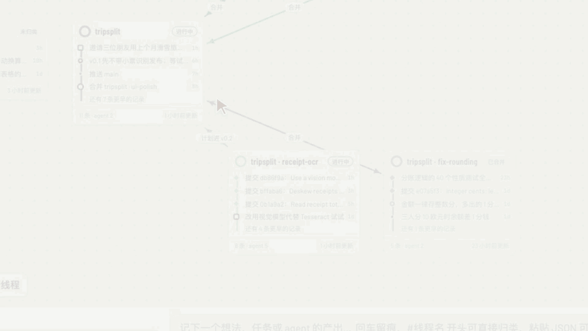

## 分组与整理

把相关的几条线放进同一个分组：用**多选**选中它们，填上分组名称后点**编组**；也可以在线的面板里直接填分组。画布上，一个分组是包住它所有卡片的一个框：拖动框的标签，整组一起移动；点标签可以改名、只整理这一组，或者解散分组（线都还在）。从分组里的线分叉出来的线会自动加入同一个分组，hook 自动建的分支线也一样。**适配**旁边的**整理**会把画布排好：收件箱在左上角，每个分组一块，每条线后面紧跟着从它分出来的线，没有分组的线放在最后。整理后的提示里可以在十秒内撤销。**专注模式**让所有视图只看一个分组：画布、分支、时间线和目标都只显示这个组里的线，「实时」栏只显示这些线上的会话，选线的菜单也只列这些线。在**更多 → 专注某个分组…**里选，或者点分组面板里的**专注这一组**；标题栏下面会有一条横栏写着当前分组，刷新后也保持，点**退出专注**恢复。命令行：`trace-canvas group <线…> --name <分组>`（`--clear` 移出分组）；`trace_list_threads` 和 `trace_read_thread` 会告诉 agent 每条线属于哪个分组。

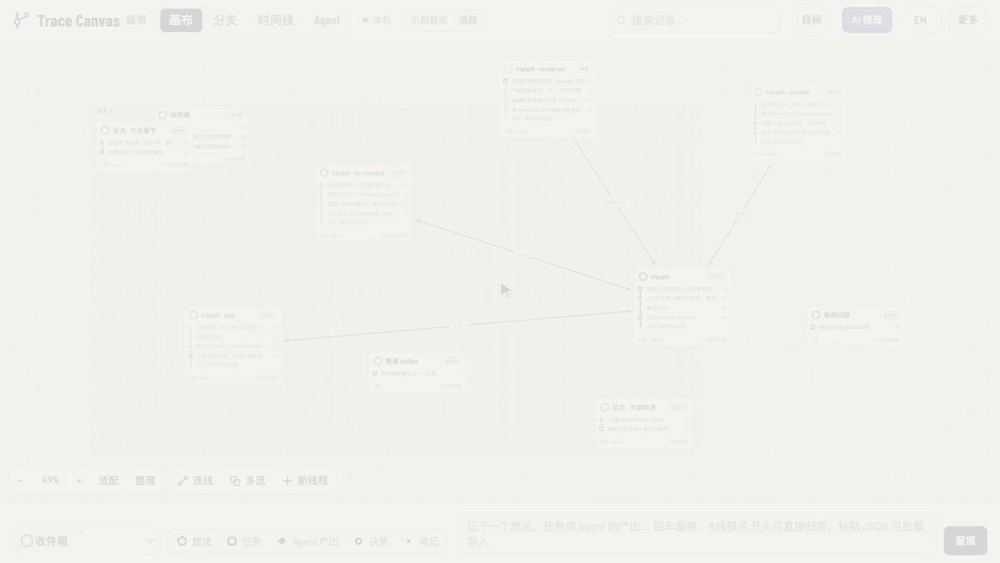

## 合并会话与线程

同一件事的多次会话可以并成一条线，有两种方式：

- **合并（merge）**：保留每条来源线路，标为已合并，像 git 一样画出合并到目标的曲线，历史都还看得见。
- **并成一条（combine）**：把所有记录按时间移到目标线程上，删除来源线程，指向它们的关联改为指向目标。

目标可以是已有线程，也可以新建。三个地方都能做：

- **画布上**：Shift+点击卡片（触屏上可以先打开工具栏的「多选」）。横栏列出选中的线，默认保留第一条，其余并进它（点另一条就改为保留那条，也可以在「合并到」里选别的线或新线程），按钮下面一行写明谁并进谁。然后点「合并」或「并成一条」。
- **Claude Code 里**：`/trace-canvas merge`，或直接说。
- **命令行**：`trace-canvas merge "问卷 A" "问卷 B" --into "问卷分析" --combine`。

另一台电脑（比如工作站）上的数据用 `trace-canvas import other-data.json` 合并进来。仓库/分支或会话的 key 相同、或名字相同的线程会并成一条，已有的记录会跳过。

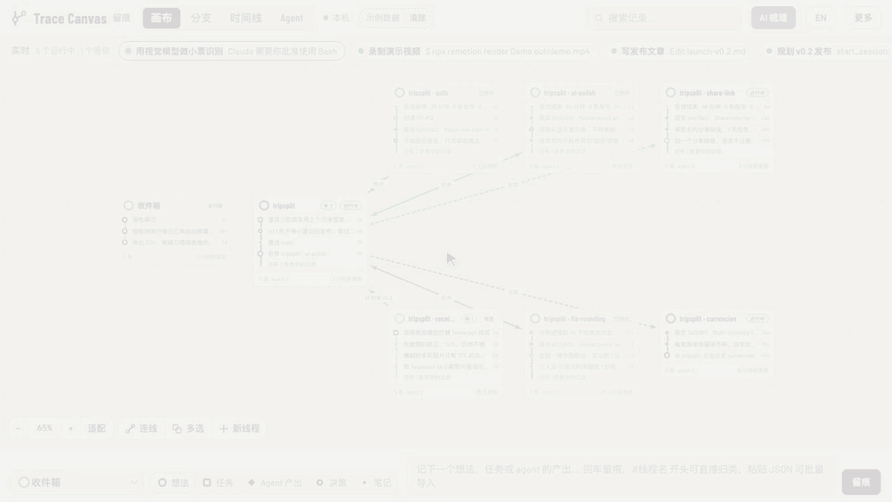

*在画布上：先近看一张卡片（深色站点是你的，彩色的是 agent 的），再 Shift 点选两条线，选择目标后点「合并」。虚构数据。*

## 调整 hooks

写在 `~/.trace-canvas/config.json` 里，或用环境变量：

| 设置 | 环境变量 | 可选值 | 默认 |
| --- | --- | --- | --- |
| `lang` | `TRACE_CANVAS_LANG` | `en`、`zh`：hooks 写入的记录用什么语言 | `en`（在页面上切换语言会一起切换） |
| `group` | `TRACE_CANVAS_GROUP` | `branch`、`repo`、`session`：一条线程代表什么 | `branch` |
| `prompts` | `TRACE_CANVAS_PROMPTS` | `first`、`long`（60 字符以上）、`all`、`none` | `first` |
| `turns` | `TRACE_CANVAS_TURNS` | `changes`（有改动的回合）、`all`、`none` | `changes` |

`TRACE_CANVAS_DISABLE=1` 可以让某个会话不留痕，`TRACE_CANVAS_HOME` 可以换数据目录，`TRACE_CANVAS_DEBUG=1` 会把每个 hook 事件写进 `~/.trace-canvas/debug.log`。

## 其他 agent 和脚本

任何 agent、脚本、定时任务都可以一行命令留痕：

```bash
node bin/trace-canvas.mjs log "文献对比表完成" \
  --thread "开题报告" --kind agent --agent Codex --link https://example.com/doc
```

不能跑命令的 agent（比如 ChatGPT）可以在回答末尾输出 JSON 行，整段粘贴进页面底部输入框回车即可，或者运行 `trace-canvas import file.jsonl`：

```json
{"thread": "开题报告", "kind": "agent", "title": "第二章提纲完成", "body": "下一步：配图", "agent": "ChatGPT"}
```

## 复盘：哪件事来回最多

一个很简单的改动，只要缺了一个细节，也可能和 agent 来回十几轮；改完没总结，下次又从头讲。线面板里的**复盘**（或 `trace-canvas retro <线程>`、`/trace-canvas retro`）读这条线在本机的 Claude Code 和 Codex 对话，用你自己的 `claude`（或 `codex`）命令行把它们分成一件件事，能对上待办的就归到那条待办。每件事算出：轮次（你发了几条）、耗时（消息之间的间隔，每段最多算 30 分钟）、回复用掉的 token、纠正了 agent 几次、在几个会话里出现过；按「轮次 ÷ 难度」排行，简单却来回多的排在最前。

每件来回多的事，会写出卡在哪（缺了什么信息）、最后说清楚的那句话，并建议一条规矩。你在某条规矩上点**写入**并选好位置之前，什么都不写：**项目规矩**（项目的 CLAUDE.md 和 AGENTS.md，放在「Rules from retros」下面）、**这条线**（线上的一条决定）、**长期记忆**（装了 Theatrum 就写进 Theatrum，否则写进 `~/.claude/CLAUDE.md`）。排行作为一条笔记留在线上。命令行：`trace-canvas retro --apply <记录> <序号> [--layer project|line|memory]`。

## Trace Canvas 花多少 token

**大约 1%，而且不随画布变大而增长。** 记录是 hook 在模型之外写的，留痕本身不花 token。进到会话里的文字都很短、有上限：开头几行（所在的线、目标、你的待办、东西在哪），每条消息一行（所在的线和最多八条已有待办），再加上 agent 主动调用 `trace_*` 工具时的返回，默认只回答会话所在的这条线。这些文字留在上下文里，之后的调用会再读一遍，所以开销跟着一个会话的消息条数走，不跟着画布大小走。`trace-canvas tokens` 读最近的 Claude Code 对话记录，列出每个会话里这部分的占比。

## AI 梳理

本机装了 `claude` 命令时，顶栏的 **AI 梳理** 会让 Claude 把收件箱里的记录归到线程、建议线程之间的关联、指出看起来停滞的线程。勾选并点应用之前不会改动任何东西。它用你自己的账号运行 `claude -p`，这次调用不会触发留痕 hooks。

## 命令

```text
页面
  trace-canvas [serve] [--port 4777] [--no-open]   启动并打开页面

记录
  trace-canvas log "标题" [--thread 线程] [--kind 类型] [--body 详情] [--link 链接] [--agent 来源]
  trace-canvas capture [--session ID] [--project 目录] [--thread 线程] [--separate] [--all]
  trace-canvas sessions [--project 目录]           列出某个项目的 Claude Code 会话
  trace-canvas merge <线程>... --into <线程> [--combine]
  trace-canvas fork <记录|线程> [--name 名字] [--bind]   从另一条线分出新线
  trace-canvas hand <待办|线程> --to claude|codex|gemini 指定由谁做，并打印启动那个 agent 的命令
  trace-canvas dispatch [线|待办...] [--all] [--print]  把每条线新记的待办（或点名的待办）交给做这条线的 agent，并叫醒它
  trace-canvas import <文件|->                     合并导出文件、另一份 data.json 或 JSON 行

目标和待办
  trace-canvas tasks [--thread 线程] [--all]       每条线的目标和未完成的待办
  trace-canvas done <待办> [--thread 线程] [--agent 来源] [--undo]
                                                   按 id 或标题勾选待办

实时会话
  trace-canvas live                                正在运行的会话：状态、当前动作、所属线
  trace-canvas bind <线程> [--session ID]          把运行中的会话放到某条线上（默认是当前会话）
  trace-canvas bind --unbind [--session ID]        改回按仓库和分支自动归线
  trace-canvas retro <线程>                        按来回轮次给这条线的事排行，并建议规矩
  trace-canvas tokens [--days 7]                   最近的 Claude Code 会话里，有多少 token 花在 Trace Canvas 上
  trace-canvas retro --apply <记录> <序号> [--layer project|line|memory]   写入其中一条
  trace-canvas resume <线程>                       这条线上的会话（新的在前）和恢复每个会话的命令

安装（--user 对所有项目，--project 目录 只对一个项目）
  trace-canvas setup            hooks + MCP 服务 + skill
  trace-canvas install-hooks | install-mcp | install-skill | uninstall-hooks
  trace-canvas mcp              以 stdio 运行 MCP 服务（由 Claude Code 启动）
  trace-canvas lang <en|zh>     hooks 写入记录的语言
  trace-canvas where            显示数据存放位置
  trace-canvas phone            在手机上打开画布（Tailscale 扫码，见 docs/phone.zh-CN.md）
```

## 在线版

同一个页面也作为 claude.ai artifact 运行，数据在 artifact 自己的数据库里：<https://claude.ai/artifact/Y7kykkrWyU4rH31MttYLMj>。本地版和在线版的数据互相独立，可以用「更多 → 导入 / 导出」搬运。

## 实现


```text
app/index.html        页面。可以连本地服务、claude.ai artifact 数据库或浏览器存储
bin/trace-canvas.mjs  命令行入口
skill/SKILL.md        /trace-canvas skill
src/server.mjs        只监听 127.0.0.1 的本地服务：页面、JSON API、用 SSE 实时推送更新
src/mcp.mjs           MCP 服务（stdio JSON-RPC，无依赖）
src/hook.mjs          Claude Code hook 处理
src/live.mjs          实时会话：每个运行中的会话、每个子 agent 各一个状态文件，由 hooks 写入
src/desktop.mjs       谁启动了谁：读取 Claude 桌面版的会话记录
src/transcript.mjs    读取 Claude Code 会话记录（~/.claude/projects/…/<session>.jsonl）
src/ops.mjs           放入会话、合并线程、合并数据集
src/git-events.mjs    从 shell 命令及其输出里识别提交、推送、合并和 PR
src/store.mjs         数据文件读写，用目录锁防止并行进程互相覆盖
src/install.mjs       添加或移除 hooks、MCP 服务、skill 和权限
src/demo.mjs          中英文示例数据
test/                 node --test 测试（npm test），含会话记录样例
docs/architecture.mjs 生成架构图（中英文两版 SVG）
docs/scenarios/       虚构的场景数据，以及生成场景截图的脚本
```

数据结构（一个 JSON 文件）：

```text
threads/<id>  name, color, status (active | parked | done | merged), parent, forkOf, mergedInto, x, y, note,
              key（repo、repo@branch 或 session:<id>）
commits/<id>  thread（或 "inbox"）, kind (idea | task | agent | decision | note | fork | merge), title, body,
              links[], agent, ts, parents[], done, mergeOf?, session?
edges/<id>    from, to, label
```

服务只监听 127.0.0.1，校验 `Host` 头，所有写操作都要带 `X-Trace-Canvas` 头，所以浏览器里打开的其他网站改不了你的数据。

在这个文件夹里运行 `npm test` 跑测试。

## 许可

MIT，见 [LICENSE](LICENSE)。
