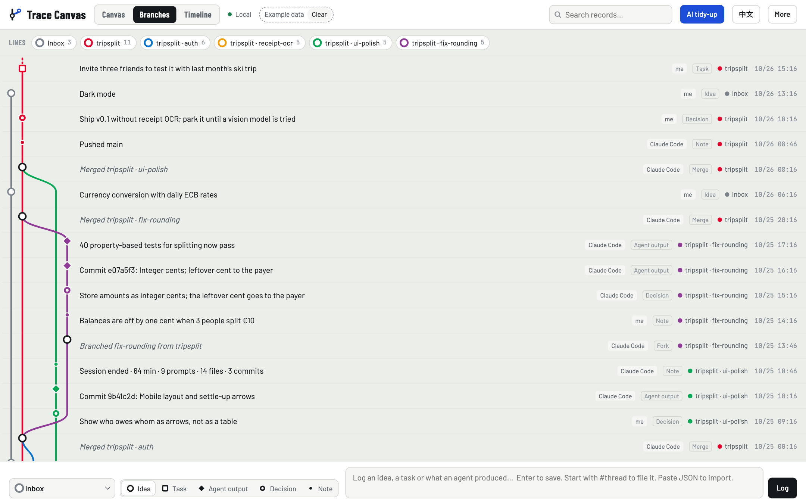
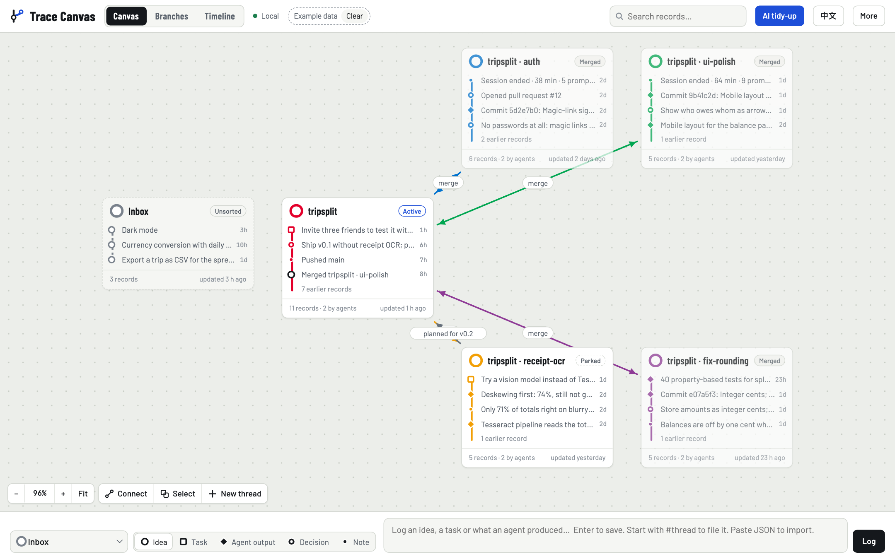
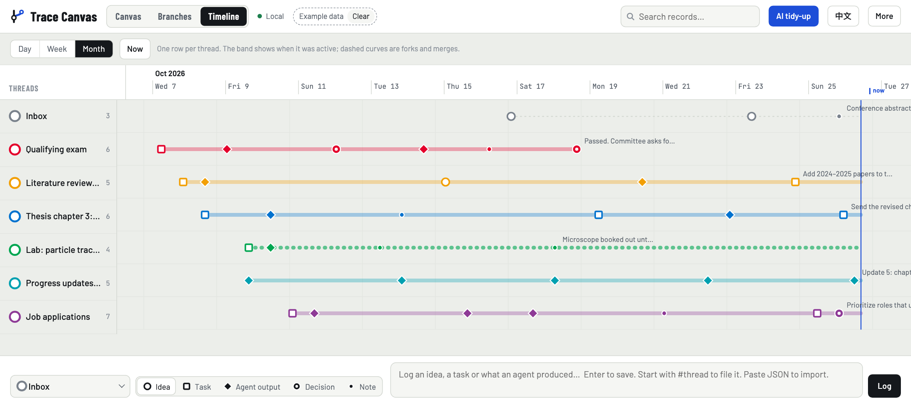
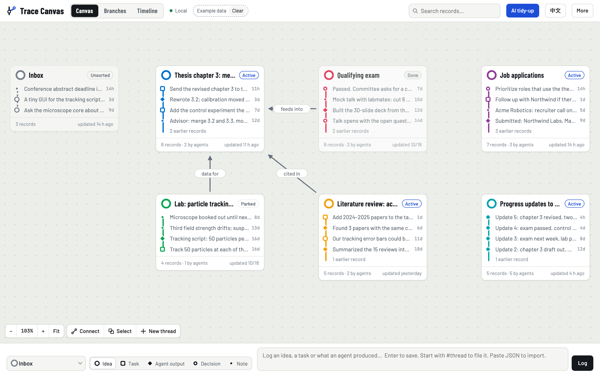
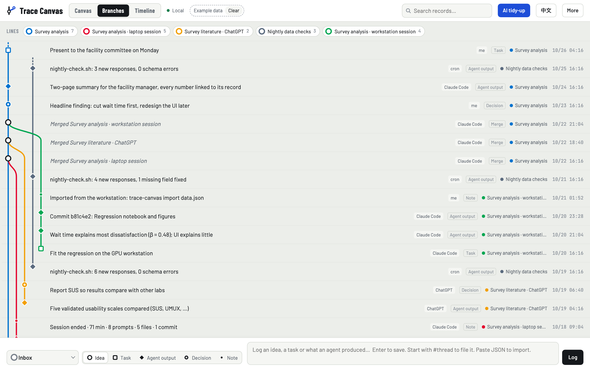

# Why Trace Canvas: scenarios, advantages and open problems

English | [中文](why.zh-CN.md)

When you work with AI agents, one piece of work often splits into several parallel sessions, branches and passing ideas, scattered across terminals, chat histories and computers. Trace Canvas records them as a transit map, so at any moment you can see four things: where each line of work stands, which agent did what, why a decision was made, and what comes next.

The three scenarios below use **made-up data**: every person, company, repository and session is invented. The screenshots are produced by [scenarios/shoot.mjs](scenarios/shoot.mjs) in a temporary folder; it never reads or writes your own `~/.trace-canvas`.

## 1. The problem it solves

| Common problem when working with AI | What Trace Canvas does |
| --- | --- |
| With three or four agent sessions open, after a few hours you lose track of which one is doing what | One line per session or branch; parallel work is drawn side by side |
| Decisions and their reasons are buried in chat history and hard to find later | Decisions are a record kind of their own, with the reason in the body, and searchable |
| A hand-written work log rarely survives more than a few days | Hooks record automatically during the session: the first instruction, turns that changed files, commits, pushes, pull requests, a session summary |
| Claude Code, Codex, ChatGPT, cron jobs and a workstation each keep their own history | The `log` command, pasted JSON lines and `import` bring them all onto one map |
| Coming back after a few days means rereading chats to pick up the thread | Every record carries `claude --resume <id>`, which takes you straight back to that session |

## 2. Three scenarios

### Scenario 1: one weekend, four agents, one app

Someone spends a weekend building `tripsplit`, a web app that splits trip expenses among friends:

1. The main session scaffolds the app.
2. Auth, receipt OCR and UI polish are then split into three parallel sessions, each in its own git worktree: two go to Claude Code, one to Codex.
3. Testing shows that three people splitting €10 come out one cent off, so a bug-fix branch is opened as well.



**What this view shows:**
- When each of the four branches left the main line and when it merged back.
- Who wrote each record: `Claude Code` records come from the hooks; `me` marks decisions logged by hand.
- The bug-fix branch keeps the whole story: the problem first, then the decision "store integer cents; the leftover cent goes to the payer", then the commit, and finally 40 passing tests.



**On the canvas, the parked line stands out.** `receipt-ocr` is marked *Parked*:
- Why it is parked: only 71% of blurry photos read correctly, and deskewing only got it to 74%.
- The next step: try a vision model.
- The main line also has the decision "ship v0.1 without receipt OCR".

Back on Monday, you know where this work is stuck and why without opening a single chat.

### Scenario 2: three weeks of a PhD student's life

Six lines of work move at the same time: thesis chapter 3, the qualifying exam, job applications, a lab experiment, a literature review and progress updates to the advisor.



**In the timeline**, each row is a line and the band shows when it was active:
- The exam ends midway; its last record reads "Passed. Committee asks for a control experiment in chapter 3".
- The lab row is dotted: the microscope is booked out, so the line is parked.
- The other lines keep moving in parallel up to today.



**The canvas** draws the relations between lines:
- the exam *feeds into* the thesis;
- the lab provides *data for* the thesis;
- the literature is *cited in* the thesis.

The **inbox** catches loose ideas, such as "ask the microscope core about weekend slots". The progress updates are drafted by Claude from the records on the canvas (through the MCP tool `trace_read_thread`), so nobody has to reconstruct the week from memory. Most of this work is not code, and Trace Canvas does not only record code: it records everything that is moving.

### Scenario 3: three agents, two computers, one line of work

An analysis of how 400 users rate a lab booking system is spread over four places:

| Source | What it did | How it reached the canvas |
| --- | --- | --- |
| Claude Code on the laptop | Cleaned the data and coded the free-text answers | Hooks, automatically |
| ChatGPT | Compared usability scales | JSON lines at the end of its answer, pasted into the page |
| Claude Code on the workstation | Fitted the regression | `data.json` exported on the workstation, then `trace-canvas import` |
| A cron job | Checks new responses every night | One `trace-canvas log` command |

Finally, **merge** joins the three lines into a single "Survey analysis" line.



**This view answers "where did this result come from?"**
- Every record names its source: me, Claude Code, ChatGPT or cron.
- After the merge the three source lines are still there, with their history kept, like in git.
- Every number in the final two-page summary for the facility manager can be traced back to the agent and session that produced it.

## 3. Advantages for vibe coding and AI collaboration

1. **Recording costs nothing.** Hooks record in the background, with no discipline required. Turns that only answer a question are skipped, so what stays on the canvas is worth keeping.
2. **Parallel work is visible at a glance.** One session or branch is one line. With N agents running, one map shows which one is moving, which has stalled and which has merged.
3. **Decisions can be traced.** Decisions are their own record kind, with the reason in the body. Weeks later you see not only *what* changed but *why*.
4. **New sessions get the background without you retelling it.** A new session can first read the line's records with the MCP tool `trace_read_thread`, then start work.
5. **You can return to any session.** `claude --resume <id>` on a record reopens that session where it stopped.
6. **It works across agents and computers.** Claude Code uses hooks and MCP; Codex and scripts use the CLI; ChatGPT uses JSON lines; another computer uses `import`. All of it lands on one map.
7. **Several sessions on one piece of work become one story.** `merge` keeps every line and the merge points; `combine` folds the records into one line in time order.
8. **The data stays on your computer.** Everything is one JSON file on your machine, with no third-party packages. The server only listens on `127.0.0.1`, and writes require a dedicated request header.
9. **AI helps tidy up, and you decide.** AI tidy-up suggests three kinds of change: where inbox records belong, which lines should be linked, and which lines have stalled. Nothing applies until you tick it.

Compared with what people usually do:

| | git log | Chat history | Kanban / notes app | Trace Canvas |
| --- | --- | --- | --- | --- |
| Automatic record | Code only | Automatic, but separate per tool | Manual | Hooks, or one command from other tools |
| Ideas, decisions, non-code work | No | Yes, but hard to find | Yes | Yes, by record kind |
| Parallel work, forks and merges | Yes (code only) | No | No | Yes |
| Across agents and computers | No | No | Manual | Yes |
| Back to the session | No | Only inside the same tool | No | `claude --resume` |

## 4. Architecture


Five layers from top to bottom:
- who acts: Claude Code, the Claude model, other agents and scripts, another computer, you;
- entry points: hooks, the MCP server, the CLI;
- logic: `hook.mjs`, `git-events.mjs`, `ops.mjs`, `transcript.mjs`;
- storage: `store.mjs` and one JSON file;
- at the bottom, the data model.

On the right are the page and the local server. The orange arrows are the live-update loop: when the data file changes, the server tells the page over SSE and the page reloads the data. The diagram is generated by [architecture.mjs](architecture.mjs); the English and Chinese versions come from the same layout.

## 5. Open problems and next steps

What is known to be missing today, and what to improve next, in order of priority.

### Problems already seen

| Problem | Today | Direction |
| --- | --- | --- |
| Hooks are sensitive to Claude Code's input format | Background-task notifications arrive as `UserPromptSubmit` and were once logged as a user instruction (fixed); the macOS `/var` link broke path comparison (fixed) | Accept only messages a person actually typed; add a fixture test for every new message type |
| Lines are split only by `repo@branch` | Different pieces of work done on `main` share one line | Add a *topic* dimension: file records by changed folder or commit prefix (a prototype, `git_to_canvas.mjs`, was written for one thesis repository), or let Claude name the topic at `Stop` |
| One JSON file, read and written whole | Fine for thousands of records, slow for tens of thousands | Move to Node 22's built-in `node:sqlite`, keeping the `mutate(fn)` interface |
| A directory lock older than 5 seconds is treated as stale | In rare cases a very slow write can be overwritten by another process | A real file lock, or SQLite transactions together with the storage change |
| Privacy | The first instruction is stored in full (up to 3,000 characters) as plain text | Strip anything that looks like a key or token before writing; an option to store titles only |
| AI tidy-up sees little | Only the latest 6 titles per line; suggestions you rejected come back next time | Keep a running summary per line; remember rejected suggestions |
| No automated tests for the page | All 19 tests cover the back end | Smoke tests for loading, switching views and writing, with the same headless Chrome approach as `shoot.mjs` |
| Local and online versions keep separate data | Only manual import and export | Two-way sync, or make one of them the clear primary |
| `SessionEnd` does not always fire | A crashed session has no summary | On the next start, check the previous session and fill the summary in from its transcript |

### Product directions

1. **New sessions pick up the background automatically (do first).** A `SessionStart` hook injects the latest decisions and open tasks of the current branch's line as context, so the agent knows where things stand from its first turn. This is the biggest win for vibe coding.
2. **Tasks tick themselves off.** A task record is marked done when its commit or pull request is merged, so plans and results line up on the canvas.
3. **Regular reviews.** A weekly review is generated automatically (the progress updates in scenario 2 are the manual version): what moved, what stalled, what to do first next week.
4. **Numbers per line.** Agent time, commits and idle days, to show where the bottleneck is.
5. **Tidying when there are many lines.** Archive finished lines, group them by project, filter by agent or time, so the canvas stays readable.
6. **JSON Canvas export.** So Obsidian and similar tools can open the map.

## Try it yourself

Import a scenario into your own canvas. Scenario data is marked as example data, so one click on **Clear** in the page removes all of it.

```bash
node docs/scenarios/scenarios.mjs vibe en > /tmp/vibe.json
node bin/trace-canvas.mjs import /tmp/vibe.json
```

The scenario can be `vibe`, `life` or `agents`. To regenerate the screenshots:

```bash
node docs/scenarios/shoot.mjs
```
