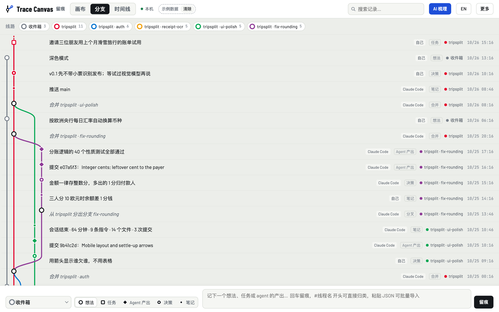
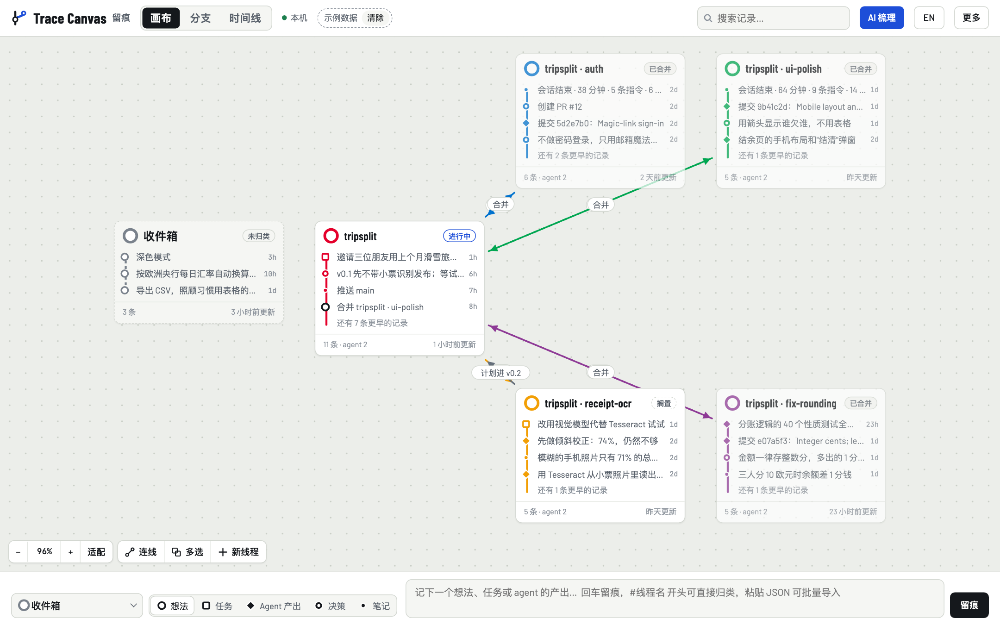
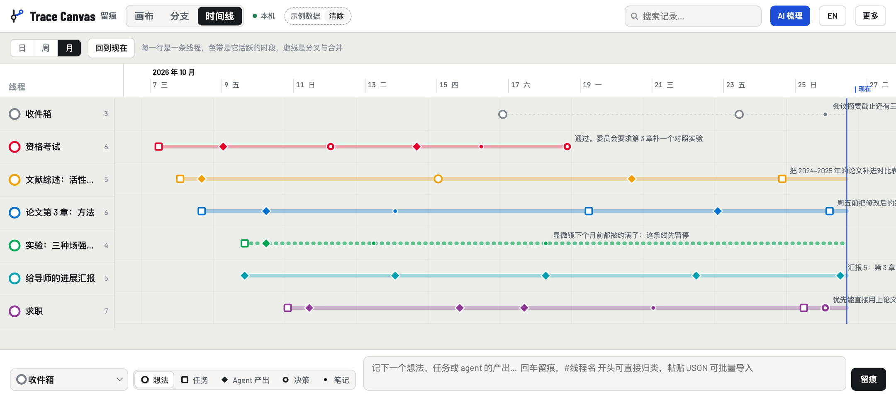
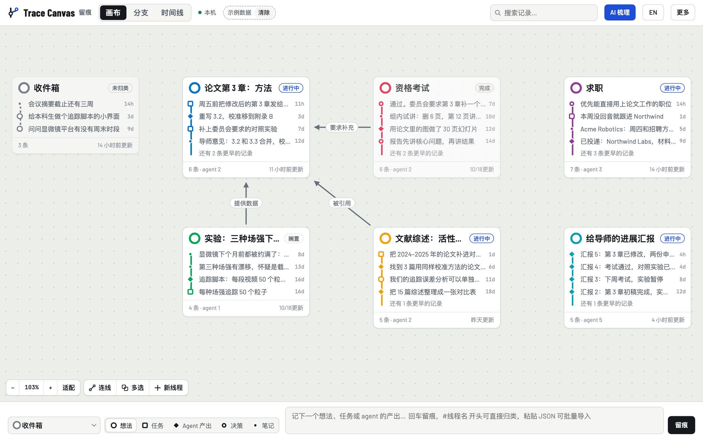
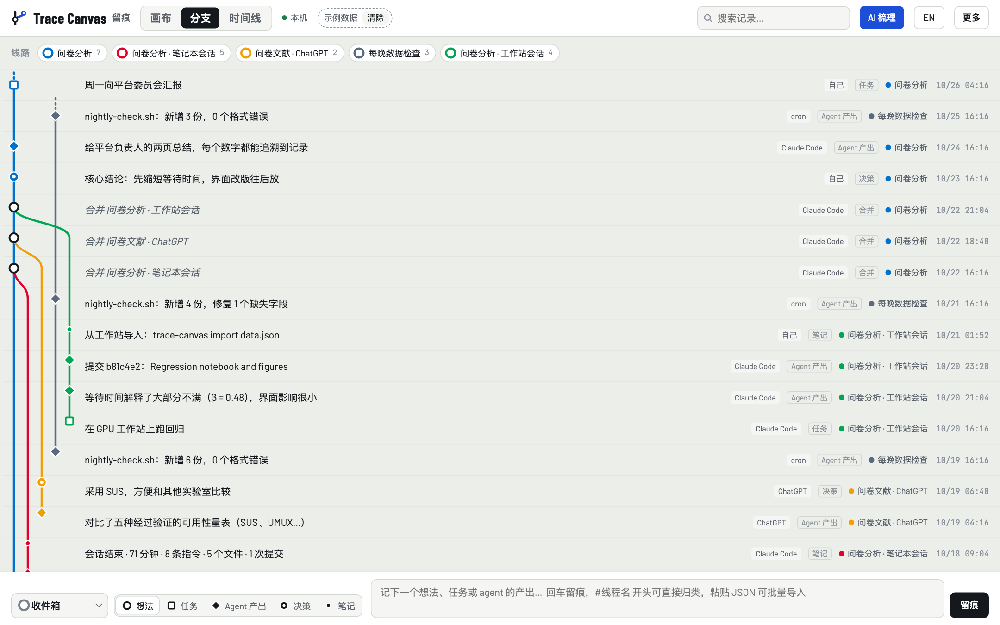
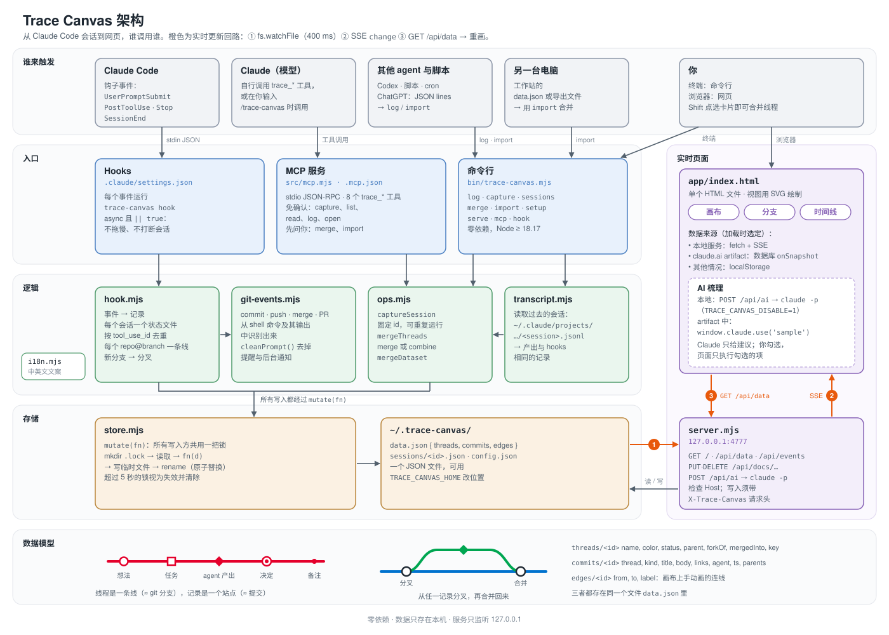

# 为什么用 Trace Canvas：场景、优势与反思

[English](why.md) | 中文

和 AI 一起工作时，一件事常常被拆成好几个并行的会话、分支和随手的想法，散在终端、聊天记录和不同的电脑上。Trace Canvas 把这些自动记成一张"地铁线路图"，让你随时看清四件事：每条工作线走到了哪里，哪个 agent 做了什么，当时为什么这样决定，下一步是什么。

下面三个场景用的都是**虚构数据**：人物、公司、仓库和会话都是编的。截图由 [scenarios/shoot.mjs](scenarios/shoot.mjs) 在临时目录里生成，不会读写你自己的 `~/.trace-canvas`。

## 一、它解决什么问题

| 和 AI 协作时的常见问题 | Trace Canvas 怎么处理 |
| --- | --- |
| 同时开三四个 agent 会话，几小时后就记不清哪个在做什么 | 一个会话或一个分支对应一条线，并行的工作并排画出来 |
| 决定和理由埋在聊天记录里，事后找不回来 | 决定单独记成一种记录，理由写在正文里，可以搜索 |
| 手写工作日志，坚持不了几天 | hooks 在会话中自动记：第一条指令、改了文件的轮次、提交、推送、PR、会话总结 |
| Claude Code、Codex、ChatGPT、定时脚本、工作站各有各的记录 | 命令行 `log`、JSON lines 粘贴、`import` 合并数据，全部汇到同一张图 |
| 隔几天回来，要从头翻聊天记录才能接上 | 每条记录带 `claude --resume <id>`，可以直接回到当时的会话 |

## 二、三个场景

### 场景一：一个周末，四个 agent，做一个应用

一个人周末做一个朋友出游分账的网页应用 `tripsplit`：

1. 主线会话先搭好骨架。
2. 然后决定把鉴权、小票识别、界面打磨拆成三个并行会话，每个用一个 git worktree：两个交给 Claude Code，一个交给 Codex。
3. 测试时发现三人分 10 欧元会差 1 分钱，于是又开了一个修 bug 的分支。



**这张图里能看到的：**
- 四条分支各在什么时候从主线分出、什么时候合并回来。
- 每条记录是谁写的：`Claude Code` 是 hooks 自动记的，`自己` 是手动记的决定。
- 修 bug 的分支留下了完整过程：先发现问题，再决定"金额一律存整数分，多出的 1 分归付款人"，然后提交，最后 40 个测试通过。



**画布视图里，搁置的那条线最显眼。** `receipt-ocr` 标着"搁置"：
- 为什么搁置：模糊照片只有 71% 识别正确，做了倾斜校正也只到 74%。
- 下一步：改用视觉模型试试。
- 主线上还有一条决定："v0.1 先不带小票识别发布"。

周一回来不用翻任何聊天记录，就知道这件事卡在哪里、为什么卡住。

### 场景二：一个研究生的三周

同时推进六条线：论文第 3 章、资格考试、求职、实验、文献综述、给导师的进展汇报。



**时间线视图**里一行是一条线，色带表示它活跃的时段：
- 资格考试在中途结束，最后一条记录是"通过。委员会要求第 3 章补一个对照实验"。
- 实验那一行是虚线：显微镜被约满，这条线暂停了。
- 其余几条线一直并行推进到今天。



**画布视图**把线和线之间的关系画了出来：
- 考试"要求补充"论文；
- 实验"提供数据"给论文；
- 文献"被引用"进论文。

另外，**收件箱**接住了零散想法，比如"问问显微镜平台有没有周末时段"。进展汇报由 Claude 读取画布上的记录来起草（通过 MCP 工具 `trace_read_thread`），不用自己从头回忆。这些场景本来就不全是写代码，Trace Canvas 记的也不只是代码，而是所有正在推进的事。

### 场景三：三个 agent、两台电脑、一条工作线

分析 400 名用户对实验室预约系统的评价，工作分散在四个地方：

| 来源 | 做了什么 | 怎么进的画布 |
| --- | --- | --- |
| 笔记本上的 Claude Code | 清洗数据、给开放题编码 | hooks 自动记录 |
| ChatGPT | 对比可用性量表 | 回答末尾的 JSON lines 粘贴进页面 |
| 工作站上的 Claude Code | 跑回归 | 在工作站导出 `data.json`，回来后 `trace-canvas import` 合并 |
| 定时任务 cron | 每晚检查新数据 | `trace-canvas log` 一行命令 |

最后用"合并"把三条线并入"问卷分析"这一条线。



**这张图回答的是"这个结论是从哪来的"。**
- 每条记录都标明了来源：自己、Claude Code、ChatGPT 或 cron。
- 合并之后，原来的三条线不会消失，像 git 一样保留历史。
- 最后写给负责人的两页总结里，每个数字都能追溯到是哪个 agent 在哪次会话里得出的。

## 三、在 vibe coding 和 AI 协作中的优势

1. **记录不费任何力气。** hooks 在后台自动记，不靠自觉。只问答、没改东西的轮次不记，所以画布上留下的都是有用的节点。
2. **并行的工作一眼可见。** 一个会话或分支对应一条线。同时跑 N 个 agent 时，哪个在推进、哪个停了、哪个已经合并，一张图就能看出来。
3. **决定能追溯。** 决定是单独的一种记录，理由写在正文里。几周后回顾，看到的不只是"改了什么"，还有"为什么这么改"。
4. **方便给新会话交代背景。** 新会话可以先用 MCP 工具 `trace_read_thread` 读出这条线的记录，再开始干活，不用你把来龙去脉重讲一遍。
5. **随时回到当时的会话。** 记录里的 `claude --resume <id>` 能直接打开当时的会话，接着做。
6. **跨 agent、跨机器。** Claude Code 用 hooks 和 MCP；Codex 和脚本用命令行；ChatGPT 用 JSON lines；另一台电脑用 `import`。最后都汇到同一张图上。
7. **同一件事的多个会话能合成一个完整过程。** `merge` 保留每条线和合并点；`combine` 把记录按时间并成一条线。
8. **数据只在本机。** 所有数据就是本机一个 JSON 文件，不依赖任何第三方包；服务只监听 `127.0.0.1`，写入还要带专用请求头。
9. **AI 帮忙整理，最后你来决定。** "AI 梳理"会给出三类建议：收件箱怎么归类、哪些线之间该连线、哪些线停滞了。每条都要你勾选后才生效。

和常见做法对比：

| | git log | 聊天记录 | 看板 / 笔记软件 | Trace Canvas |
| --- | --- | --- | --- | --- |
| 自动记录 | 只记代码 | 自动，但每个工具各存各的 | 手动 | hooks 自动，其他工具一行命令 |
| 想法、决定、非代码的工作 | 无 | 有，但很难找 | 有 | 有，并按类型区分 |
| 并行、分叉与合并 | 有（只限代码） | 无 | 无 | 有 |
| 跨 agent、跨机器 | 无 | 无 | 手动 | 有 |
| 回到当时的会话 | 无 | 只能在同一工具里翻 | 无 | `claude --resume` |

## 四、架构



从上到下分五层：
- 谁触发：Claude Code、Claude 模型、其他 agent 与脚本、另一台电脑、你自己；
- 入口：hooks、MCP 服务、命令行；
- 逻辑：`hook.mjs`、`git-events.mjs`、`ops.mjs`、`transcript.mjs`；
- 存储：`store.mjs` 加一个 JSON 文件；
- 底部：数据模型。

右侧是网页和本地服务。橙色箭头是实时更新的回路：数据文件一变，服务就通过 SSE 通知网页，网页重新拉取数据。图由 [architecture.mjs](architecture.mjs) 生成，中英文两版来自同一份布局。

## 五、反思：还能做什么

下面是目前能确认的不足，以及下一步可以优化的方向，按优先级排列。

### 已经暴露的问题

| 问题 | 现状 | 改进方向 |
| --- | --- | --- |
| hooks 对 Claude Code 的输入格式很敏感 | 后台任务的通知会走 `UserPromptSubmit`，曾被当成用户指令记下（已修）；macOS 的 `/var` 链接导致路径比较出错（已修） | 只认真正由人输入的消息；为每种新出现的消息类型加样例测试 |
| 只按 `repo@branch` 分线 | 在 main 上做的几件不同的事挤在同一条线上 | 增加"主题"维度：按改动目录或提交前缀自动归线（仓库里的 `tools/git_to_canvas.mjs` 是一个原型），或者让 Claude 在 `Stop` 时给出主题 |
| 一个 JSON 文件整体读写 | 几千条记录没问题，几万条会变慢 | 换成 Node 22 内置的 `node:sqlite`，接口保持 `mutate(fn)` 不变 |
| 目录锁超过 5 秒视为失效 | 极端情况下，一次很慢的写入可能被另一个进程覆盖 | 改用文件锁，或随存储一起换成 SQLite 的事务 |
| 隐私 | 第一条指令的全文（最多 3000 字）明文保存 | 写入前去掉看起来像密钥或令牌的内容；可配置只存标题 |
| AI 梳理看到的信息少 | 每条线只看最近 6 个标题；你拒绝过的建议下次还会出现 | 给每条线维护一段摘要；记住被拒绝的建议 |
| 网页没有自动化测试 | 19 个测试都只覆盖后端 | 用 `shoot.mjs` 同样的无头 Chrome 方式，做打开、切换视图、写入的冒烟测试 |
| 本地版和在线版数据不同步 | 只能手动导入导出 | 增加双向同步，或者明确只保留一个为主 |
| `SessionEnd` 不一定触发 | 会话崩溃时缺少会话总结 | 下次启动时检查上一个会话，从会话记录里补上 |

### 产品方向

1. **新会话自动接上背景（优先做）。** 用 `SessionStart` hook，把当前分支所在线最近的决定和待办作为上下文注入新会话。agent 一开始就知道做到哪了，这是 vibe coding 中收益最大的一项。
2. **待办自动打钩。** 任务记录在对应的提交、PR 合并后自动标记完成，让"计划"和"完成"在画布上对得上。
3. **定期回顾。** 每周自动生成一份回顾（场景二的进展汇报就是手动版），列出推进了什么、哪些停滞、下周先做什么。
4. **每条线的统计数字。** agent 工作时长、提交数、停滞天数，用来发现瓶颈在哪。
5. **线多了的整理。** 归档已完成的线、按项目分组、按 agent 或时间筛选，线一多画布就不会乱。
6. **导出 JSON Canvas。** 让 Obsidian 等工具也能打开这张图。

## 自己试一试

把一个场景导入自己的画布：场景数据都带有"示例数据"标记，页面上点一下"清除"就能全部删掉。

```bash
node tools/trace-canvas/docs/scenarios/scenarios.mjs vibe zh > /tmp/vibe.json
node tools/trace-canvas/bin/trace-canvas.mjs import /tmp/vibe.json
```

场景名可以是 `vibe`、`life` 或 `agents`。重新生成截图：

```bash
node tools/trace-canvas/docs/scenarios/shoot.mjs
```
